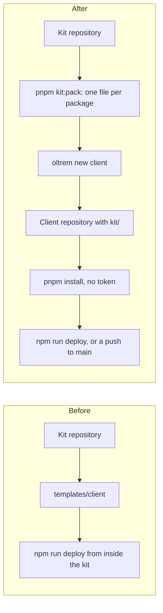

# One repository per client

> **In plain words.** Until now a client's portal could only be built from inside the kit's own
> repository. Now each client can have a repository of its own, private, under the owner's
> account. `oltrem new client` makes one: a copy of the client template, named after the client,
> with the kit itself inside it in a `kit/` folder. Installing it needs no account, no token and
> no registry, on a computer or in GitHub Actions. Nothing is published anywhere; a registry may
> come much later, and that is the owner's call.

## What changed

| Before | Now |
|---|---|
| Every kit package was TypeScript source only, read by the workspace. Outside the kit, Node cannot load it from `node_modules`. | Each package builds to JavaScript and declarations in `dist/` (`scripts/package.mjs`), and its packed `package.json` points there. Inside the kit nothing changes: the workspace still reads `src/`. |
| A packed package would have lacked its licence, and the tool's templates. | `pnpm pack` adds `LICENSE` to every package, and the client and module templates to the tool's. `pnpm kit:pack` packs all 39 packages in one go. |
| A client portal lived in `templates/client/` inside the kit. | `oltrem new client <dir> [--name N] [--git]` makes a client repository: the template copied, `package.json` pointed at `kit/` (`file:./kit/<file>`), the Worker and its resources named with the same rule as the first deploy, the pointer files, migrations and reference written. It refuses a folder that is not empty. |
| `oltrem check files` held the kit-owned files. | It also holds `kit/`: every `file:./kit/` dependency must exist, and every file there must be named. `kit/README.md` says the folder is never edited. |
| A kit upgrade meant a newer package from somewhere. | `oltrem upgrade --from <folder>` replaces the files in `kit/` and repoints the dependencies, then the usual `oltrem upgrade` runs. |
| Nothing proved a client repository worked outside the kit. | `pnpm check:client-repo` makes one from the packed kit and runs its checks. |

Every kit package stays `private: true`. No organisation, no registry, no release workflow and no
token were added.

## How a client is made, before and after

Before, the client's portal could only be built and deployed from inside the kit. After, the kit
packs itself, `oltrem new client` puts those files in a fresh repository, and that repository
installs and deploys on its own. Deploying from `templates/client/` inside the kit still works
as before.

## Two kit tests fixed on the way

A real client repository showed two tests of the client template that only passed for the
template itself:

- `test/screens.test.ts` picked the first scope in a list sorted by name, which was the company
  only while the client was named as the template is. It now picks the scope the member does not
  hold yet.
- `test/worker.test.ts` expected exactly the kit's jobs, so it failed as soon as a client added a
  module with a job. It now leaves the client's own modules out of that count.

The client template's `tsconfig.json` no longer extends the kit's root settings, which a client
repository does not have; a test holds the two equal.

## How it was verified

- `pnpm check:client-repo`, on 2026-11-01, passed in 136.5 s:

  | Step | Time |
  |---|---|
  | pack the kit (39 packages, built) | 66.3 s |
  | `oltrem new client` named "Acme Ltd" | 0.1 s |
  | `pnpm install --offline` | 3.2 s |
  | `oltrem setup` | 3.5 s |
  | `oltrem new module pet-food` | 2.2 s |
  | the client's `pnpm verify` | 58.3 s |
  | `oltrem doctor` | 2.9 s |

- `kit/` holds 40 files (39 packed packages and its README), 1404 KiB.
- A second install with `--frozen-lockfile --offline` worked; the lockfile records each file's
  checksum, so a changed file in `kit/` is refused.
- The tool's tests for `new client`, `upgrade --from` and the `kit/` check, the packing tests in
  `scripts/package.test.mjs`, and the kit's own `pnpm verify`.

`pnpm check:client-repo` takes over two minutes, so it is not a gate of `pnpm verify`; it is run
by hand before a kit release.
