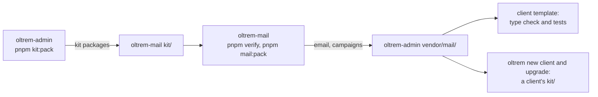

# Email and campaigns moved to Oltrem Mail

> **In plain words.** The owner chose (2026-11-02) to give every mail feature its own private
> repository, oltrem-mail. Its first phase moved the kit's two mail modules there. The kit now
> keeps a packed copy of each in `vendor/mail/`, so a client portal still has email exactly as
> before: the same package names, tables, routes and hook addresses. Nothing is published, in line
> with the owner's decision that Oltrem stays private.

## What changed

| Before | Now |
|---|---|
| `modules/email` and `modules/campaigns` in this repository | the same modules in oltrem-mail; here, `vendor/mail/` holds their packed files and `oltrem-mail.json` (the mail commit, the kit commit it was tested against, each file's fingerprint) |
| the client template named them `workspace:*` | it names their packed files (`file:../../vendor/mail/...`); `pnpm-workspace.yaml` overrides every mention of them to those files and links the kit packages they name to this workspace (`linkWorkspacePackages: deep`), so nothing of the kit is looked for on a registry |
| `pnpm kit:pack` and `oltrem new client` packed every folder | they pack every folder and copy the two packed mail files as they are; a new client's `kit/` holds the same set as before |
| `oltrem check deps` took any non-catalog range as an error | a mail module is named only by its packed file, and a version is refused |
| the manifest gate and the module boundaries covered email | they cover the kit's own folders; oltrem-mail runs its own manifest check |
| the kit's changesets named the mail modules | those lines moved to oltrem-mail; one changeset that named only mail moved whole |

## How the two repositories trade packages

The kit's packages are all 0.0.0 for now, so the copy names the kit commit it was tested against
instead of a version range. A kit change that breaks mail shows here first: the client template's
type check and tests run the packed mail modules. The steps to take a newer copy are in
`vendor/mail/README.md`.

## How it was checked

- The client template's type check (Worker and pages) and its 50 tests pass with the packed mail.
- The command-line tool's tests: a packed kit has both mail files; a `file:` range into
  `vendor/mail/` becomes the client's `kit/` file; an upgrade swaps them like any kit package.
- The deps gate refuses a mail module named by a version; the package test counts every kit
  package, folder or packed copy.
- `pnpm verify` and `pnpm check:client-repo` pass; their summary lines are in the commit message.
