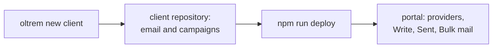
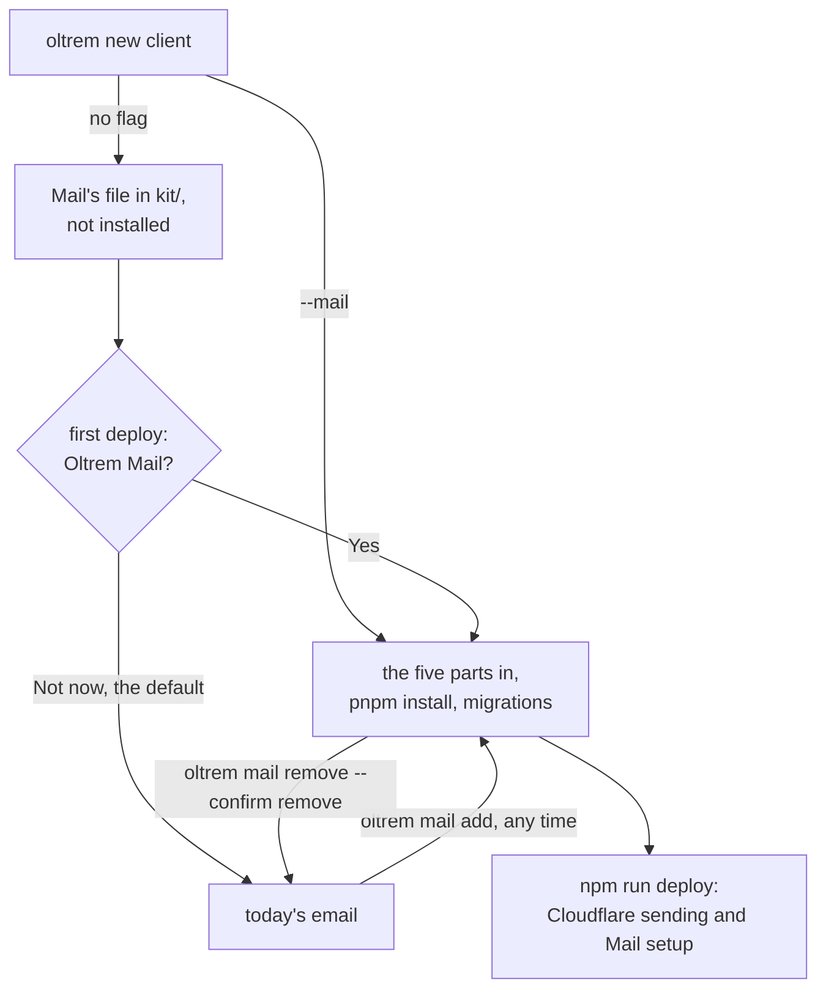

# Oltrem Mail chosen, added and taken out by the tool

> **In plain words.** Oltrem Mail (sending through Cloudflare, with a Mail setup page) is now an
> add-on a portal has only when someone chooses it. The owner chose on 2026-11-02 that a portal
> without it keeps today's email: its providers, Write, Sent and Bulk mail. The command-line tool
> now offers it in the three places a person meets it: `oltrem new client --mail`, one question
> on the first deploy (no by default), and `oltrem mail add` or `oltrem mail remove` at any time
> later. Every client repository already holds Mail's packed file, so adding it needs no
> download. `oltrem mail try` sends a test email into the portal running on the same computer,
> and `oltrem mail status` and the doctor say when Mail is only half in, with the command that
> fixes it.

## What changed

| Before | Now |
|---|---|
| the kit carried email and campaigns only | it also carries `@oltrem/mail` (vendor/mail/, Oltrem Mail's phase 3 pack): the Cloudflare route, the Mail setup page, and email's one-press provider card |
| nothing to choose | a portal has Mail when `src/mail.ts` wires it in; the template's `src/mail.ts` leaves it out, and `src/index.ts` builds Mail only when it is there |
| a new client got every kit package in `package.json` | every new client gets Mail's packed file in `kit/`, but `package.json` names `@oltrem/mail`, and `migrations/` holds its migration, only with `--mail` |
| the first deploy had no Mail step | on the first deploy, when `kit/` carries Mail, step 4 asks "Should this portal have Oltrem Mail?" before the key; a yes adds Mail's rights to the key's steps and adds Mail in step 5, before the migrations and the deploy |
| no command for it | `oltrem mail status`, `add [--from <folder>]`, `remove --confirm remove`, `try` |
| the Modules question always showed every part | Mail's switch shows only where Mail is in (`partsHere`) |
| no check | the doctor's `MAIL-01`, and the deploy, stop on a Mail half in |

## How a portal gets Mail

Before, a portal had the email the kit gave it, and nothing more:

Now Mail is a choice, made once at any of three moments, and undone the same way:

The five parts that make "Mail is in": `package.json` names the package (a client repository),
`src/mail.ts` hands it to the Worker, `wrangler.jsonc` has the `send_email` binding `EMAIL`, the
manifest names that binding, and the token registry lists the key's three Mail rights. `add`
works every edit out before writing any, so a refusal changes nothing, and it finishes a
half-done add. `remove` keeps Mail's data in the database and drops its migration files, so a
later `add` applies nothing twice. Only `src/mail.ts` names the binding, so a portal without
Mail passes the manifest check.

## Impact on each part

| Part | Impact |
|---|---|
| A client portal without Mail | none: it builds and sends as before |
| A client portal with Mail | one more binding (`EMAIL`, a cap of one), plane `30` and the error block `4000` (docs/architecture.md), migration `1001`; the key needs Zone DNS Edit, Zone Email Routing Rules Edit and Account Email Routing Addresses Edit |
| The first deploy | one question when Mail is available; the key's form chooses DNS Edit, and its steps name the two rights the form cannot choose; a pasted key that cannot list verified addresses is said in one line |
| The kit | the template always installs `@oltrem/mail` for its own lockfile and checks; the deps, manifest and parts checks know the add-on |
| oltrem-mail | unchanged: its packed folder is taken as it is (`oltrem mail add --from`, or vendor/mail/) |

## How it was checked

- The tool's tests for Mail: a new client with and without `--mail`; add, a second add, and a
  remove that gives back exactly the files there were; a failed install and its next step;
  `--from` checked against its fingerprints; the refusals; the half-in state and `MAIL-01`; the
  kit template's mode; each text edit and its undo; `mail try` against a stand-in for wrangler's
  local address; the deploy's question (yes, no, a failed install, a Mail half in).
- The template's type check, Worker and pages, and its 50 tests, each with Mail out and with
  Mail put in by `oltrem mail add` and taken out again; its manifest check both ways. Its tests
  expect Mail's module, job and health check only where `src/mail.ts` wires it in.
- `pnpm check:client-repo`: a client repository made from the packed kit, then inside it
  `oltrem mail add`, `pnpm verify`, `oltrem mail status`, `oltrem mail remove --confirm remove`
  and `pnpm verify` again; the summary is in the commit message.
- Not checked here: a real deploy with the `send_email` binding, and a real Cloudflare key's
  Mail rights. They wait for the owner's own test portal.
