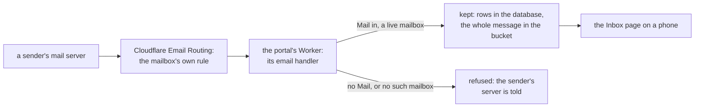

# Oltrem Mail's inbox in the portal

> **In plain words.** A portal with Oltrem Mail now keeps the mail people send to the business's
> own addresses, such as hello@ or bookings@: each mailbox is made on the Inbox page, its mail
> arrives through Cloudflare, and the team reads and answers it on a phone. A portal without Mail
> refuses all mail, as before, so nothing is kept by accident. On the computer that builds the
> portal, a mailbox can be made without Cloudflare, so `oltrem mail try` shows the whole path
> working. The kit's own test of this path found that Mail's first inbox build never stored a
> message on Cloudflare; Mail fixed it the same morning, and the test now guards it. Mail's
> consent work (phase 5) came in with it.

## What changed

| Before | Now |
|---|---|
| the Worker had no way in for mail | its default export has an `email` handler: each arriving message goes to Mail's inbox, which keeps it only for a live mailbox's address; without Mail, or on a Worker built for another client, every address is refused |
| Mail had no bucket and did not know the Worker | Mail is built with the portal's one bucket (each whole message under `mail/inbox/`) and the Worker's name (the client id, which `wrangler.jsonc` names it by), where each mailbox's routing rule sends its mail |
| a mailbox needed Email Routing, so none could be made on a computer | on the computer that builds the portal (no Access door), a mailbox needs no Email Routing and no rule (Mail's local mode) |
| every hook answer was `no-store` | a successful answer to a GET that asks to be kept for ever (`immutable`) keeps its own Cache-Control, so the inbox's reader script (about 365 KB) is fetched once a version instead of on every page |
| `oltrem mail try` waited for the inbox | it mails the portal on the computer; a refused address says to add a mailbox; `oltrem mail remove` says to switch the mailboxes off before the deploy |
| Mail's phase 3 pack | its phase 5 pack (oltrem-mail b6370d5): migrations `1002` (mail: the inbox) and `1003` (email: consent, in every portal), the setting `campaigns.warmup`, and postal-mime and DOMPurify installed with Mail only |

## How mail reaches a portal

Before, a portal could only send; mail to its domain went wherever its DNS said, never to the
portal. Now, for a portal with Mail and a mailbox:

The handler does no work of its own: it checks that the Worker was built for this client, then
hands the message to Mail, which owns what is kept, searched and shown (its README, "The inbox").

## Impact on each part

| Part | Impact |
|---|---|
| A portal without Mail | one more handler, which refuses every address; nothing else changes |
| A portal with Mail | mailboxes, kept mail and the reader; mail is stored in the bucket it already has, with no new binding |
| `@oltrem/core-http` | the one exception to `no-store` on hooks, described in its README |
| The tool | `mail try` and `mail remove` say more; nothing new to type |
| oltrem-mail | the receive fix (b6370d5) and its tests now hand in a native stream, as the runtime does |

## How it was checked

- The kit's Worker test mails the portal twice: an address that is no mailbox is refused, and
  with Mail in, a live mailbox's message is kept, with its row and its stored copy under
  `mail/inbox/`. Its first run hung: the message stream the runtime hands in, once split in two,
  cannot be piped into the fixed-length stream a bucket write needs ("Inter-TransformStream
  ReadableStream.pipeTo() is not implemented"), so every message would have hung on Cloudflare.
  Mail's own tests had used a JavaScript stream, which hides it. Nine stream shapes tried in the
  portal's runtime showed the fix, a JavaScript pass-through on the stored half; Mail shipped it
  in b6370d5, and the test passes.
- The portal's 51 tests pass with Mail out and with Mail put in by `oltrem mail add`; the core-http
  test of the hook cache answer; the tool's tests for `mail try` and the inbox's migration.
- The kit's `pnpm verify` and `pnpm check:client-repo` (Mail added, verified, removed, verified);
  their summaries are in the commit message.
- Not checked here: mail delivered by real Email Routing to a deployed portal, and the reader on
  a phone. They wait for the owner's test portal.
