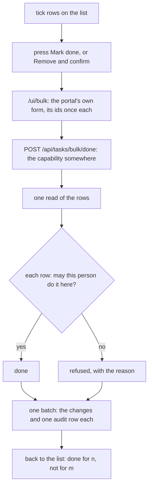
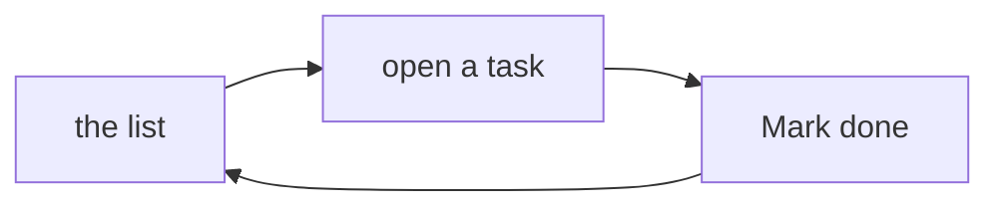

# Bulk actions

> **In plain words.** On the tasks list, each row now has a tick box. Tick several, then press
> one button, "Mark done" or "Remove", and it is done for all of them at once, instead of opening
> each task in turn. Each ticked row is still checked on its own: a task the person may not
> change is left as it was, and the page says how many were done and how many were not. Remove
> asks first. Any module can offer the same on its own lists. It is the open-source ideas' R2,
> the second of the owner's "Everyday features".

## What changed

| Part | Change |
|---|---|
| `@oltrem/core-module` | a module may declare `bulk` actions; each adds `POST /api/<module>/bulk/<id>` with `{ ids }`, one to 100, repeats dropped; `BulkAction`, `BulkOutcome`, `BULK_MAX` |
| `@oltrem/core-audit` | `statements(entries)`: audit rows as statements for the caller's own batch |
| `@oltrem/iam` | `auditStatements(options, actor, rows)`: the same, naming the actor and policy as `recorded` does |
| `@oltrem/core-ui` | `BulkBar`; `Table` takes `select`, a named tick on each row and card and one in the header |
| `@oltrem/screens` | the post `/ui/bulk` and the notice of what a press did; the frame script counts ticks, keeps a row's two ticks alike, ticks a whole page and holds the buttons until one is ticked |
| `@oltrem/tasks` | Mark done and Remove for many tasks, each by its one-task rule |

How one press travels:

Before, each task was opened and changed alone: ten tasks were ten pages and ten presses, each
its own request.

## Decisions

- **Each row by its own rule.** The route needs the capability somewhere; the module then checks
  every row as its one-row action would. A refusal never stops the others.
- **Inside the free plan.** At most 100 rows a press; one read and one batch, so a press costs two
  database calls whatever the count, and one audit row per record in that batch.
- **Kit words only on the page.** The notice says how many were done and refused in fixed words;
  the reasons are in the API's answer and the audit log. Words from the address would let a link
  someone sends put any sentence on a portal page.
- **Without the script it still works.** The ticks and the bar are plain form fields; the script
  only counts and holds the buttons.
- **Two ticks per row** (the table and the phone card both render): the script keeps them alike
  and the server keeps each id once.

## Impact on each part

| Part | Impact |
|---|---|
| Client portals | the tasks list gains the ticks and the bar with the next template update; no migration |
| Oltrem Mail | none yet; its lists may declare `bulk` later |
| The free plan | two database calls a press; no KV |

## How it was verified

- Tests: core-module (the route under its capability, one to 100 ids, repeats dropped, a bad
  action refused), core-audit (`statements` written in one batch, hashed so `verify` passes, a bad
  entry refused), core-ui (the ticks in the bar's form with names, the header tick, the bar's
  form, the dialog of a destructive action), tasks (a person's own done and others refused with
  reasons, a missing id named, remove only where they manage, six audit rows), the client template
  (the bar on a list of two, the page passing the accessibility check, nothing ticked, done for
  each once, removed from Done, a crafted `why` never shown, an unknown action, a form from
  elsewhere refused). The full verify chain.
- Not verified: ticking on a phone, the count and the held buttons in a real browser (the frame
  script runs in no test), a portal on Cloudflare (no sandbox yet).
