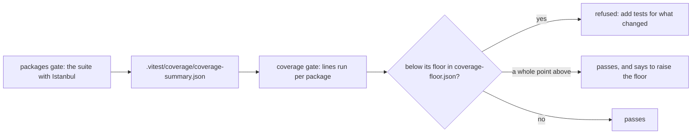
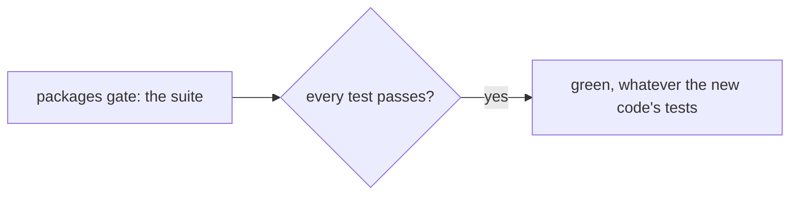

# Test coverage per package, held so it only rises

> **In plain words.** The kit's tests now also count which lines of each package they actually
> run. Each package has a floor, the whole per cent it reached on the day this was added, and
> `pnpm verify` refuses a change that brings a package below its floor. So new code comes with
> its tests, or the push stops with the package named and what to do. The owner said yes to the
> one tool this needs on 2026-11-03; it is used only by the tests and never ships in a portal.

## What changed

| Part | Change |
|---|---|
| `@vitest/coverage-istanbul` | a tool dependency (the catalog, `tools/package.json`, the dependency registry); the Workers pool supports Istanbul only |
| `vitest.config.ts` | coverage of every `packages/*/src` and `modules/*/src` file, written as a JSON summary into `.vitest/coverage/` (not committed) |
| `scripts/lib/gates.mjs` | the `packages` gate runs the suite with `--coverage`; a new `coverage` gate after it |
| `scripts/lib/coverage.mjs`, `scripts/check-coverage.mjs` | the summary added up per package, compared with `coverage-floor.json`; `--raise` writes higher figures, never lower ones |
| `coverage-floor.json` | 37 floors, from 83 (`packages/core-ui`) to 100 |
| `scripts/lib/size.mjs` | the size gate's wording corrected: a Worker's start runs under its own 1-second limit, not a request's 10 ms ([the kit review](../reference/kit-review.md), K2) |

Before, the suite said only pass or fail: a module could grow untested code and verify stayed
green.

## Decisions

- **Whole per cents.** A floor is the measured figure rounded down, so a run that differs by a
  line never fails, and a real drop does.
- **Only raised.** `node scripts/check-coverage.mjs --raise` writes the measured figures where they
  are higher and adds a new package; it never lowers one. Lowering is the owner's call, in the
  commit.
- **Lines, per package.** One figure per package or module is what a person can read; the file
  detail is in the summary for whoever looks.
- **Inside verify, not beside it.** The coverage run replaces the plain test run, so the tests run
  once; the price is time: the packages gate took about 160 s and takes about 320 s with Istanbul.

## Impact on each part

| Part | Impact |
|---|---|
| Client portals | none: the tool is never bundled; a client repository's own verify is unchanged |
| The kit's `pnpm verify` | about 3 minutes longer: 501 s on 2026-11-03, against about 300 s before |
| Oltrem Mail | none |

## How it was verified

- `node --test scripts/coverage.test.mjs`: 5 pass (the summary added up by package, below a floor
  refused, no floor refused, a floor left behind refused, a raise noted, raising never lowers).
- `pnpm exec vitest run --coverage`: 1035 tests in 114 files pass; 37 packages measured.
- The full verify chain with the new gate; its summary is in the commit.
