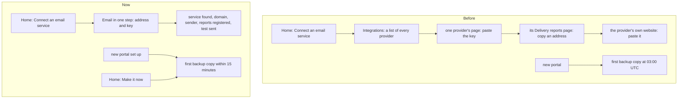

# Easier setup

> **In plain words.** The owner asked for processes that do not send people from page to page,
> with the providers checked automatically. Setting up email now starts on one page that does
> everything: paste the address mail comes from and the service's key, and the portal finds the
> service, sets up the domain and the address, registers delivery reports and sends a test. Home's
> Get started list sends people straight there. Connecting a service the long way also registers
> its delivery reports by itself now, so nobody copies an address into the provider's website. A
> new portal makes its first backup copy within a quarter of an hour of being set up instead of
> waiting for the night, and Home has a Make it now button for it.

## What changed

| Part | Change |
|---|---|
| `@oltrem/screens` | Integrations (`/providers`) leads with **Email in one step** when the email module is mounted, a button to Oltrem Mail's one-step setup (`/email/connect`); the provider tiles below it are the way by hand. Connecting a provider by hand also calls `POST /api/email/instances/:id/reports`, which registers delivery reports at Resend, Brevo or Mailjet by their API. Home's email step leads to `/email/connect` when email is on. A Get started step with an `action` is a row with its button; `POST /ui/get-started` reads the module's steps again and calls only that step's route. Home shows what a change did, or why it was refused, as a toast |
| `@oltrem/core-module` | `OnboardingStep.action`: a button label and a path among the module's own API routes; any other path is dropped from the step |
| `@oltrem/core-jobs` | `startFlow(workflow, kind, params, id?)`: given a name, Workflows starts the instance once |
| `@oltrem/backup` | The job `backup.first` (every fifteen minutes) starts a new portal's first copy once the settings and both keys are there, once ever, under the name `backup-first-copy`. Its Get started step has **Make it now** once backups are set up, and says who it waits for before then |

How a new portal gets to working email and a first backup:

Before, setting up email took four pages and a visit to the provider's own website, and the
first backup waited for the night. Now it is one page, and the backup starts by itself.

## Decisions

- **Alerts needed nothing.** The owner's ask included "notify the right people automatically";
  `oltrem deploy` already writes the Vendor's address, and the client's Owner when it is a real
  one, into `alerts.recipients` while it is empty, so a new portal's alerts reach someone.
- **A button only when it can work.** Make it now appears once the backup settings and keys are
  there; before that the step says it waits for the Vendor, instead of offering a press that is
  refused.
- **The form names nothing but a place.** Home's button posts the module and the step's place; the
  screens read the steps again, so a form cannot make the screens call any other route.
- **Free plan.** The first-copy job reads one row every fifteen minutes until an export exists,
  then nothing (the isolate remembers); a start is one Workflow instance.
- **Left for later.** Messages that say "an Owner sets it in Settings" (a currency, a sending
  address, a file size limit) still send the person to Settings; the field in place is the next
  step. The Mail add-on owns `/email/connect` and the Ready to send fix lines.

## Verified

- `pnpm verify`: see the commit.
- Screens tests: Integrations shows Email in one step; connecting Resend by hand registers its
  webhook (`POST https://api.resend.com/webhooks`); Home's email step links `/email/connect`; a
  step with a button is done from Home, a step or module without one calls nothing, a form from
  another site is refused, and a refusal comes back on Home with its status.
- Backup tests: the first copy starts once set up, never twice (same isolate or another), never
  when an export exists; the step's note and button follow the setup.
- core-module and core-jobs tests: an action outside the module is dropped; a named start.

Not verified: a real phone (P54 to P56 in [the phone tests](../phone-tests.md)), and a real
provider's webhook registration from a deployed portal (the sandbox account, K3).
