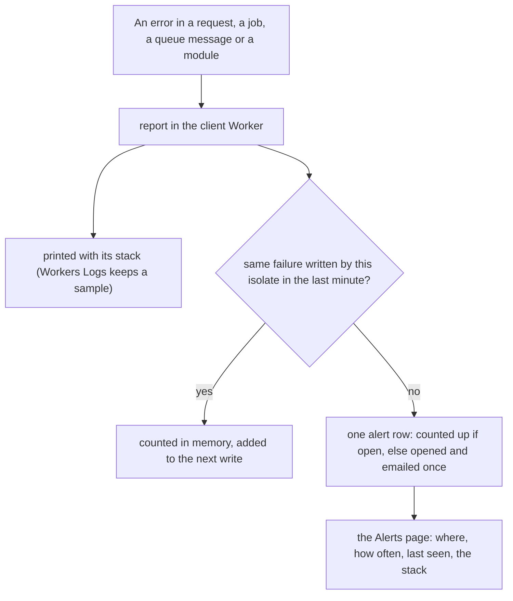

# Every server error kept

> **In plain words.** Until today a server error in a client portal printed one line with its
> message and nothing else, and Cloudflare keeps only one request in ten in its logs, so nine
> errors in ten left no trace at all. Now every error is kept in the portal's own database as an
> alert: the same failure counts up on one row instead of making a new one, the owner is emailed
> once, and the Alerts page shows where it happened, how often, when it was last seen and the
> lines of code it came from. A failing loop cannot use up the day's database writes.

## What changed

| Part | Change |
|---|---|
| `@oltrem/alerts` | `reportError(env, { error, area, ref })`: an error becomes a warning keyed `error.<area>.<fingerprint>`; a raise may count more than once (`times`) |
| `@oltrem/cli` | the Node stand-in for `cloudflare:workers` (used to read a client's modules for its reference) also exports `env` and `waitUntil` |
| the client template | `report` prints the stack, not only the message, and hands every error to `reportError` under `waitUntil` from `cloudflare:workers`; the pipeline passes the request id as the reference |

How it works now:

Before, the same error went only to `console.error` with its message, and a sampled log was the
only place it could be seen.

## Decisions

- **Reuse, not a new table.** The alerts module already keeps a problem once by its key, counts
  repeats, emails once and lists them; an error is one more problem. No migration, no setting.
- **The fingerprint** takes numbers, ids and quoted values out of the message before hashing, so
  "row 41 not found" and "row 7002 not found" are one failure. An id inside the area (a queue
  message's) moves to the reference.
- **Writes are capped** at one per key per isolate per minute; the occurrences between are added
  to the next write. A key's first error is always written at once.
- **Warning, not critical**: errors respect the quiet hours.

## Impact on each part

| Part | Impact |
|---|---|
| Client portals | errors appear on the Alerts page and in the alert email; existing portals get it with the next template update |
| Oltrem Mail | its modules report through the template's `report`, so their errors are kept too, with no change there |
| The free plan | at most one D1 write per distinct error a minute per isolate |

## How it was verified

- `modules/alerts` tests (11 pass): the fingerprint groups messages that differ only by numbers
  and quoted values; within a minute repeats are held and added to the next write (raised 1, then
  4); the source, title, reference and stack are kept; a refused database never throws.
- The cli's 277 tests pass (17 failed until the stand-in exported `waitUntil`). The full
  verify chain: 12 gates passed in 347.8 s.
- The client template's 51 tests pass, and its type check; the template's uncaught-exception lines
  in the test run were already there before the change (20 before, 18 after).
- Not verified: a real portal on Cloudflare (no sandbox yet, finding K3), and how `waitUntil`
  from `cloudflare:workers` behaves under production load.
