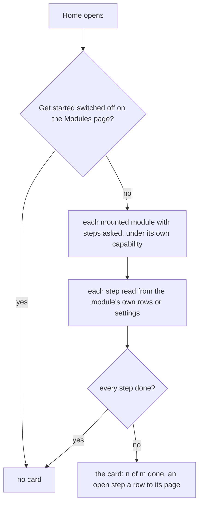

# Get started on Home

> **In plain words.** A new portal now tells its Owner what to do first, on Home: connect an
> email service, invite a second person, make the first backup copy, run a restore drill and name
> who gets alerts. Each step ticks itself when the thing is really done (the portal reads its own
> tables and settings; nothing is ticked by a click), and the card goes away once every step is
> done. Someone who cannot do a step does not see it. The card can be switched off on the Modules
> page like the other extras. It is the first of the everyday ideas (R3 of
> [the open-source ideas](../reference/open-source-ideas.md)).

## What changed

| Part | Change |
|---|---|
| `@oltrem/core-module` | a manifest may declare `onboarding`: a capability and `steps(ctx)`; `defineModule` adds `GET /api/<module>/onboarding`, portal pages only, at most five steps |
| `@oltrem/screens` | Home asks each mounted module with steps, beside Needs you and the cards, and shows "Get started: n of m done" while one is open |
| `@oltrem/core-config`, `@oltrem/cli` | the settings part's extra `settings.get-started`, so the card has its switch on the Modules page |
| `providers`, `users`, `backup`, `alerts` | one step each (backup two), read from an active email instance, a second active person or a pending invitation, an `ok` copy and drill in `backup_runs`, and the alert recipients setting |

How Home builds the card:

Before, Home began with Needs you; a new Owner had no list of first steps.

## Decisions

- **Ticked by what is stored.** A step is never marked done by hand: a dismissed step that is not
  really done would hide a real gap (no email service means no invitations and no alerts).
- **No new table or setting.** The steps read what each module already keeps; the switch is one
  more id in the existing parts list.
- **The asked-for steps that are not here:** naming the company happens before Home exists (the
  Vendor's company form), and adding a place is optional for one-place businesses; choosing modules
  is already the Modules page. They can be added as steps later without changing the contract.
- **The cost:** four more in-process API calls on Home, each one D1 read; Home stays inside its
  40-query share (the template's budget test).

## Impact on each part

| Part | Impact |
|---|---|
| Client portals | a new portal's Owner sees the card with the next template update; a portal already set up sees nothing, since its steps are done |
| Oltrem Mail | none; Mail's modules may add their own steps later |
| The free plan | one D1 read per module with steps on each Home view, no writes |

## How it was verified

- Tests: core-module (the route, portal pages only, at most five), providers, users, backup and
  alerts (each step's state and its capability), and the client template (the card on a new
  portal reads "0 of 5 done"; switched off on the Modules page it is gone, switched on it is back;
  Home within its query share). The full verify chain.
- Not verified: the card on a phone, and a portal on Cloudflare (no sandbox yet).
