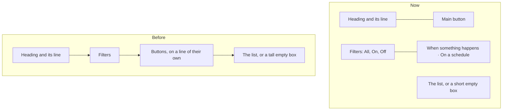

# Look 2, step 2

> **In plain words.** The owner asked again whether every remark about the portal's look had
> been met (2026-11-03, 19:42 UTC). It had not, so every page was photographed on a phone and a
> computer and checked against the remarks. This step fixes what still fell short: each page's
> main button now sits beside its heading or at the end of its filter row instead of on a line
> of its own; the "nothing here yet" boxes are smaller; a link or secret shown once now comes up
> in the corner like every other outcome and waits there until closed; the notification choices
> are a neat grid of switches that save as they flip; the Look page shows each palette as a
> gradient tile and each background as a small piece of itself; and adding a location opens in
> a dialog like every other "add".

## What the check found

Every page of the template portal (25 addresses, 50 screenshots at 390 and 1366 px) was looked
at against the owner's remarks of 2026-11-03 (06:34 and 06:38 UTC).

| Remark | Found | Done here |
|---|---|---|
| Pages all look the same, too many rows | heading, then filters, then a button alone on its line, then a large empty box, on nearly every page | the button moves up beside the heading or the filters; the empty box is about a third shorter |
| Every notification a pop-up in the corner, on the whole repo | outcomes already were, except four shown-once results printed in the page: an invitation link on Home, the invitations made on Users, a file's share link, a webhook's signing secret | all four are corner toasts with `keep`: they stay until closed, because what they show cannot be shown again |
| Lean, modern, not from the 2000s | the notification choices were seven rows of four chips each, cut off on a phone | one grid: a row per module, two switches (In the portal, By email), saved as one flips |
| Palettes with gradients and patterns | 24 palettes and 7 backgrounds existed, shown as small dots and words | a tile per choice: the palette's gradient, the background drawn small; the picked one ringed |
| Users & access consistent and clear | Roles and Groups add through a button, Locations showed its whole form on the page | Locations adds through a button and a dialog |

Tried and taken back: Home's cards two to a row on a phone. At 390 px their titles ("Email, last
24 hours") wrapped onto three lines and "None yet" overflowed, so the phone keeps one card a row.

## What changed

| Part | Change |
|---|---|
| `@oltrem/core-ui` | `ChipRow` marks its row `ui-filters`, `CommandRow` and `ActionRow` `ui-cmds`; `.ui-page` is a grid that puts a command row beside the heading or the filters it follows, from 640 px; `EmptyState` is compact; `Notice` takes `keep`; a toast scrolls inside itself past 70% of the screen; `.ui-picks` and `.ui-pick` draw choice tiles |
| `@oltrem/screens` | the four shown-once results in `Toasts`; Notifications' choices as a switch grid posting `seen-`, `portal-` and `email-` fields per module; the Look page as tiles (`preview` in `looks.ts`), its Save only without the script; Locations' add form in a dialog |
| Frame script | a toast marked `data-keep` is never timed out |
| Modules | the empty-state icons drawn at 20 px to fit the smaller disc (16 modules, no other change) |

How a page's top is laid out now, on a computer:

## Decisions

- **No limit raised.** The stylesheet stays under its 64 KiB test, at 64,493 bytes of 65,536;
  the grid and the tiles cost about 950 bytes, and the rest of the step is markup.
- **Research behind it.** One main action per page in the header, relevant to the whole page
  ([Shopify Polaris, page](https://shopify.dev/docs/api/app-home/polaris-web-components/layout-and-structure/page));
  a short empty state with one clear next step
  ([SaaSFrame, empty states](https://www.saasframe.io/blog/saas-empty-state-design-examples));
  notification preferences as a grid of categories by channels
  ([SuprSend, preference centre](https://www.suprsend.com/post/notification-preference-center)).
- **A shown-once result stays.** A toast that went well leaves after six seconds; one holding a
  link or a secret would take it away before it was copied, so it waits for its ×.
- **The Owner's look for everyone** is not in this step: the portal's own look is still set in
  the client's configuration, and each person picks theirs on the Look page.

## Verified

- `pnpm verify`: see the commit.
- Screens tests: the notification grid's fields, email only, both off and back to both.
- Screenshots of every changed page at 390 and 1366 px in the template portal on this computer.

Not verified: a real phone (P46 to P49 in [the phone tests](../phone-tests.md)), Safari and
Firefox.
