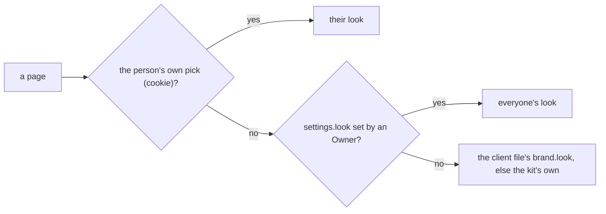

# Look 2, step 3

> **In plain words.** The second round of the owner's look pass. Every "nothing here yet" box now
> looks the same on every page (some had a box, some had none). On a computer, each setting
> shows its name and explanation on the left and its box and Save on the right, like the
> settings pages of the tools people know. The Developer jobs table gives each job's name room.
> And an Owner can now press "Make it everyone's look" on the Look page: the colours and
> background they picked become the portal's own, for everyone, at once and without a deploy.
> Each person can still pick their own.

## What changed

| Part | Change |
|---|---|
| `@oltrem/core-ui` | `EmptyState` carries `ui-empty`: its own dashed box, which a list's box (`border-dashed`) takes away so there is never a box in a box; `.ui-setting`, words and control side by side when the page is 44rem wide or more |
| `@oltrem/core-config` | `LOOK_SETTING`, `settings.look`: `<palette>.<background>` or empty, Owner-editable, immediate, always registered by the settings module |
| `@oltrem/screens` | `look` may be a function read on each page; the Look page offers Make it everyone's look to an Owner or the Vendor (`POST /ui/look/everyone`, saved through the settings API, their own cookie cleared); a setting row is a `ui-setting` grid |
| Client template | `partsOff` also keeps `settings.look` from the same memory, and the screens' look is that, else the client file's `brand.look` |
| `@oltrem/developer` | the Job column keeps 12rem for the job's name and line |

How the look a page carries is chosen now:

Before, the middle step was missing: the portal's own look changed only with the client file
and a deploy.

## Decisions

- **No new read.** The setting rides on the read the parts already make on every request, from
  the settings' memory; the page's look costs nothing more.
- **The Owner's own pick is dropped** when they make a look everyone's, so they see what
  everyone sees.
- **No limit raised.** The stylesheet is at 64,791 bytes of its 65,536 test after this step.

## Verified

- `pnpm verify`: see the commit.
- Screens tests: Make it everyone's look shown to the Owner, saved, carried by a page with no
  cookie, and reset.
- Screenshots of every page at 390 and 1366 px in the template portal on this computer.

Not verified: a real phone (P50 to P52 in [the phone tests](../phone-tests.md)).
