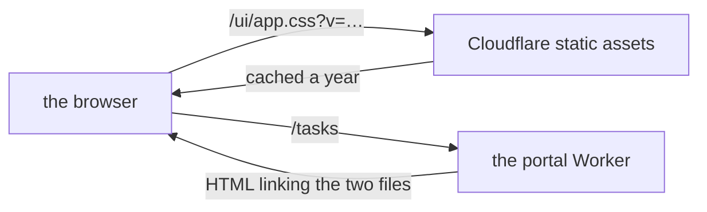
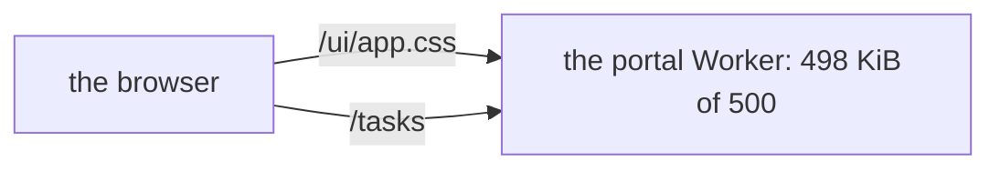

# Look 2, step 1

> **In plain words.** The owner found the portal's pages heavy: big grey buttons everywhere, and
> notices printed into the page like a form from the year 2000. This first step of the remake
> makes the controls smaller and softer (chips on one tinted row, buttons and fields a little
> lower under a mouse), shows every notice as a small card at the bottom right that leaves by
> itself when all went well, and folds the "Find" forms into one field with its arrow inside.
> To make room for the next steps, the stylesheet and the frame's script are no longer inside
> the Worker: Cloudflare serves them as plain files, which is free and does not count against
> the Worker's CPU. The owner chose this on 2026-11-03 over raising either limit.

## What changed

| Part | Change |
|---|---|
| `@oltrem/core-ui` | `ui-chip`: 36 px chips (32 under a mouse) on a soft row, the open one tinted in the primary colour; buttons, fields and page links 36 px under a mouse, 40 under a finger (`pointer-fine:`); `Notice` is one card with its tone's bar and a close button; new `Toasts` and `SearchField`; the unused `Toast` and `ToastRegion` removed |
| `@oltrem/core-ui` page parts | `Done` and `ProblemNotice` render inside `Toasts`, so every page that uses them shows a toast without a change of its own |
| `@oltrem/screens` | a page's flash, a bulk result and done line go into `Toasts`; Parts and Settings use `SearchField`; the frame's script times a toast out after 6 s (paused while pointed at or focused), closes it on ×, and shows a lost connection as a danger toast |
| `@oltrem/screens` build | the stylesheet and script are written to `public/ui/` with their versions in `src/generated/versions.ts`, not into the Worker's code; Tailwind's colour-mix fallbacks are dropped (every supported browser has `color-mix`); `public/_headers` caches `/ui/*` for a year, immutable |
| Client template | `wrangler.jsonc` gains `"assets": { "directory": "node_modules/@oltrem/screens/public" }` |
| `@oltrem/cli` | `oltrem deploy` adds that line when it is missing (`withAssets`), and `oltrem upgrade` writes it into an older client's file once |

How a page gets its style now:

Before, the Worker carried both files in its own code and answered them itself:

## Decisions

- **No limit raised.** The Worker's 500 KiB budget and the stylesheet's 64 KiB test stay as they
  were. The Worker went from 498.3 to 477.5 KiB compressed; the stylesheet from 65,535 to 64,133
  bytes.
- **Assets before the Worker.** Cloudflare answers a file in `public/` before the Worker runs,
  so a `/ui/*` request costs no Worker CPU and no request of the daily allowance. The Access door
  already leaves `/ui/*` open, so the sign-in page is styled.
- **A toast for every notice.** A good result leaves by itself after 6 seconds; a warning or a
  refusal stays until closed, and keeps `role="alert"` so a screen reader says it at once.
  Bottom right on a computer, at the foot on a phone, above the page.
- **Colour tints in oklab.** Mixing an oklch colour with white drifted blue tints towards pink;
  the new tints and four older ones mix in oklab.
- **Not yet** (the next steps of this remake): Users and access as a permission matrix, the
  ready colour palettes and backgrounds, and a pass over each page's arrangement.

## Impact on each part

| Part | Impact |
|---|---|
| Client portals | the new screens arrive with `oltrem upgrade`, which adds the assets line in the same step and says so in its notes; a file it cannot place the line in is reported |
| Oltrem Mail | its pages get the toasts through `Done` and `ProblemNotice`; `SearchField` is there for its search |
| The free plan | fewer Worker requests (style and script are static), a smaller Worker, nothing new stored |

## How it was verified

- Tests: core-ui 49 (the chips, the toast's roles and close button, the search field), screens 34
  (the stylesheet's size, the public files in step with their source, the cache headers), the
  cli's `withAssets`, the client template's screens 43 (the Worker no longer serves the
  stylesheet, the page links both files with a version, the primary button's classes).
- Screenshots on a 390 px phone and a 1366 px computer of Home, Tasks, Settings and Parts, with a
  toast after a done change.
- The full verify chain.
- Not checked: a portal on Cloudflare serving `/ui/*` from its assets (the owner's phone tests
  P34 to P36).
