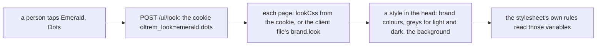

# Looks: palettes and backgrounds

> **In plain words.** The owner asked for many ready colour palettes with good gradients and
> patterns. Each person can now open **Look and colours** from their account menu and pick one of
> 24 palettes (Indigo, Emerald, Sunset, Graphite and twenty more) and one of 7 backgrounds (Soft
> wash, Plain, Aurora, Sunrise, Dots, Grid, Lines). A tap changes the whole portal at once, in
> light and dark. The choice stays on their device, so nobody else is affected, and a client's
> portal can start in a look of its own.

## What changed

| Part | Change |
|---|---|
| `@oltrem/screens` | `looks.ts`: the palettes (a primary, an accent, greys leaning to its hue) and the backgrounds as data, and `lookCss`, which writes a look's variables for both themes and its background; the page `/look` and `POST /ui/look`; every page carries the chosen look in `<style id="ui-look">`; the account menu's Look and colours |
| The frame's script | a form marked `data-autosave` sends itself when a choice changes; the look's style follows a page swapped in place |
| `@oltrem/core-config` | `brand.look` in the client file, the portal's look until a person picks one |
| The client template | hands `brand.look` to the screens |

How a page gets its look:

Before, every portal had one blue look, and the theme switch only chose light or dark.

## Decisions

- **No stylesheet cost.** The stylesheet already reads `--brand-*` and `--ui-*` variables, so a
  look is only those variables and one background rule, written in the page's head (about a
  kilobyte, nothing for the kit's own look). The stylesheet stays at 65,071 bytes inside its
  64 KiB test.
- **A cookie, not a stored row.** Picking a look writes nothing to the database or KV, so it
  costs nothing on the free plan; it follows the person on that device.
- **Only the kit's lists.** The cookie holds two ids; anything else is the kit's own look, so
  nothing typed ever reaches the style.
- **Colour in OKLCH.** Each palette is a hue and a strength; the lightness of each role (primary,
  greys, dark theme) is the kit's, so every palette keeps the same contrast. The bright hues
  (lime, amber, sand) use a darker primary so white text on it reads.
- **Not yet:** an Owner choosing the portal's look from the portal for everyone (today the client
  file's `brand.look`); a look per company in the shared vendor server.

## Impact on each part

| Part | Impact |
|---|---|
| Client portals | the next kit update; no migration; `brand.look` optional |
| Oltrem Mail | its pages take the look like every page |
| The free plan | no write; about a kilobyte more in a page that has a look |

## How it was verified

- Tests: `looks.ts` (ids, the cookie over the portal's own, no style for the kit's own, both
  themes, the backgrounds, nothing that could close the style), the frame's autosave, the client
  template (the page with its 24 palettes passing the accessibility check, the cookie, the style
  on the next page, an unknown id falling to the kit's own, reset).
- Driven in Chromium at 390 px and 1366 px on the local portal: Emerald with Dots, Sunset with
  Aurora, Ocean with Aurora on Home, Violet with Grid in dark on Tasks.
- The full verify chain.
- Not checked: the owner’s phone (P40).
