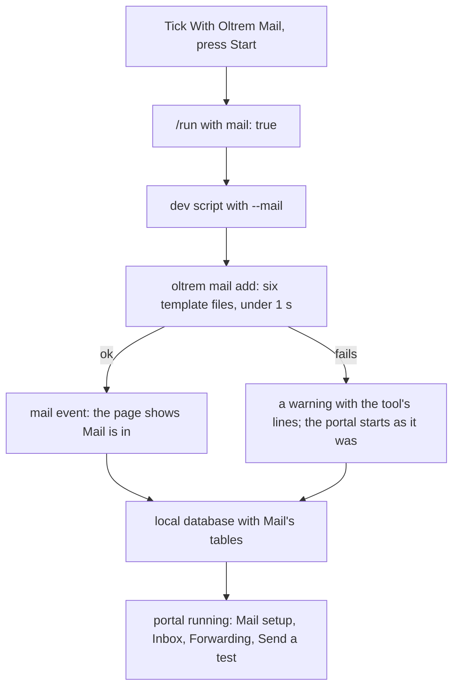
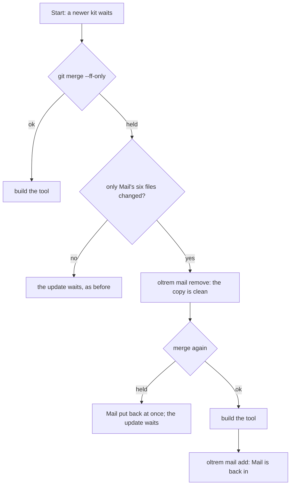

# Oltrem Mail with one tick on the start page

> **In plain words.** To try Oltrem Mail on a computer, the start page's **Try it here** card now
> has a **With Oltrem Mail** tick. Tick it and press Start: Mail comes in, then the portal starts
> with Mail setup, the Inbox, Forwarding and **Send a test**. Untick it and press Start to take it
> out again; what Mail stored stays. Before, this took a terminal command
> (`oltrem mail add templates/client`) that the start page never mentioned. While Mail is ticked
> in, the start still brings in a newer kit by itself: it takes Mail out for the update and puts it
> back after.

## What changed

| Part | Change |
|---|---|
| `packages/cli/src/setup-page.ts` | `StartStatus.mail` (carried, in); `/run` takes `mail`; `forkScript` adds `--mail` or `--no-mail`; a `mail` event updates the status a page opened later sees |
| `packages/cli/src/setup-page-html.ts` | the tick on Try it here, shown only when the kit carries Mail; `mailTick` decides what Start sends: only a change |
| `templates/client/scripts/dev.mjs` | `--mail` and `--no-mail` run `oltrem mail add` or `oltrem mail remove --confirm remove` before the database step, so Mail's tables come in the same start; the flags never reach wrangler |
| `scripts/run.mjs` | the start reads Mail's state for the page; an update held back only by Mail's own files (`MAIL_FILES`) moves Mail aside and back |
| `vendor/mail/`, `templates/client/migrations/` | the Mail pack of oltrem-mail d05900e: forwarding without Cloudflare on a computer, Send a test, and the Cloudflare route's test sent again by itself once the domain is onboarded for Email Sending (migration `1008_mail_test_again.sql`) |

## How it works now

Before, the tick did not exist: Mail came in only through `oltrem mail add` in a terminal, and
the page gave no hint of it.

## Decisions

- **Only a change is sent.** The tick follows what the start found until it is touched, so a
  Start that changes nothing runs nothing extra.
- **The dev script owns it**, not the page: `npm run dev -- --mail` does the same from a terminal,
  and in a client repository too.
- **A failure never stops the portal.** If Mail cannot come in or go out, the start says why and
  the portal starts as it was.
- **The key's Mail rights are not checked on a later deploy:** the key is a Worker secret whose
  value cannot be read back, so the portal's Mail setup page checks them instead (as before).

## How it was checked

- `packages/cli/test/setup-page.test.ts`: `/run` hands `{ mail: true }` to the run and nothing for
  a value that is not true or false; a `mail` event reaches a page opened later; `forkScript`
  passes `--mail`, `--no-mail` or nothing; `mailTick` sends only a change.
- `scripts/launch.test.mjs`: every `MAIL_FILES` path exists; `changedFiles` reads git's porcelain
  lines, renames by their new name; `onlyMail` is false when anything else changed.
- `scripts/template-dev.test.mjs`: `mailOf` takes the flags out of what goes to wrangler.
- By hand on 2026-11-03: `oltrem mail add templates/client` changed exactly the six `MAIL_FILES`
  in 1.1 s, and `remove` left `git status` clean.
- Not checked here: the page in a real browser on Windows (the phone and PC steps cover it).
