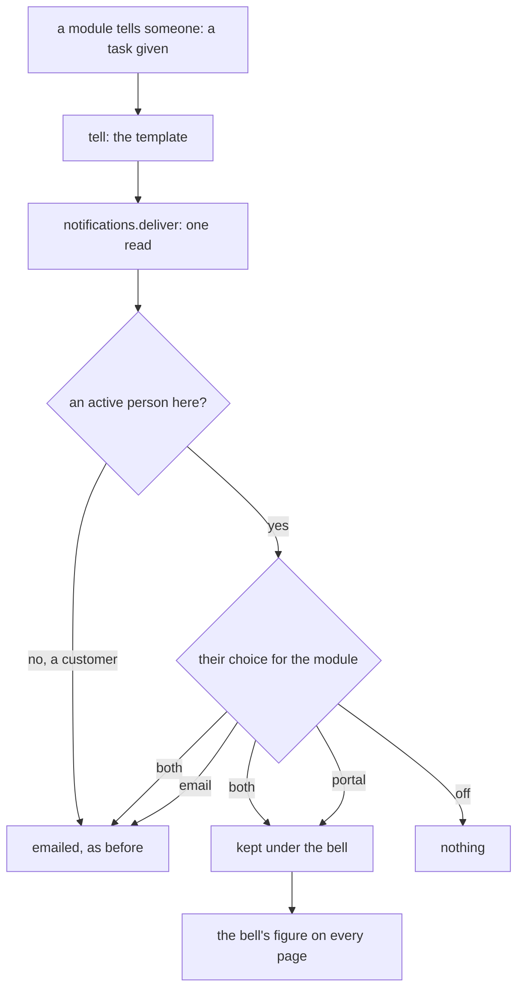
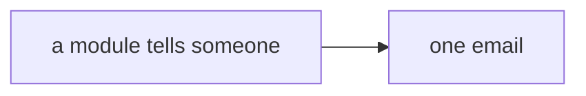

# Notifications

> **In plain words.** Each person now has a bell. What the portal tells them, a task given to
> them, their time off answered, their shifts published, waits under the bell as well as in
> their email, so it is not lost in an inbox full of other mail. On the Notifications page each
> person picks, for each kind, portal and email, portal only, email only, or off. Until they
> pick, they get both, as before. It is the open-source ideas' R6, the third of the owner's
> "Everyday features".

## What changed

| Part | Change |
|---|---|
| `@oltrem/users` | migration `0056`: `users_notifications` and `users_notify_choices`; `notifications.deliver`, the routes under `/me/notifications`, the daily job that removes rows after 90 days; a privacy request lists what the person was told |
| `@oltrem/screens` | the bell in the sidebar and the phone's bar with the unread figure; the page `/notifications` with All and Unread, Mark all read, the rows, Older, and "How you are told" |
| `@oltrem/screens` build | the frame's script is carried without its comment lines and indents: 38 KiB to 27 KiB, 11.1 to 7.9 KiB compressed, which pays for the notifications inside the Worker's 500 KiB budget |
| The client template | the messages of tasks, approvals, time off, expenses, equipment, shifts and quotes go through `tell`: kept and emailed as each person chose |

How a message travels now:

Before, each module emailed the person and nothing else:

## Decisions

- **Both by default.** A person who never opens the page loses nothing: the email still goes.
- **One call in the template, not in each module.** The modules keep their `send`; the template's
  `tell` decides. A module added later joins with one line and a row in `NOTIFIES`.
- **The link is a path.** A row leads to the last portal address in the message, its path only,
  else the module's first page; another site's address never.
- **Cost.** Two database calls a message (one read, one batch); one indexed read a page for the
  bell, made beside the read of who is signed in; no KV.
- **Opening is a link.** A row is a plain link that marks it read and goes to its page, the way
  mail does; it changes only the person's own read mark.
- **Not yet:** the daily summary email, push to a phone (R10), a person choosing per kind of
  message inside a module.

## Impact on each part

| Part | Impact |
|---|---|
| Client portals | migration `0056` applies with the next template update; the bell on every page |
| Oltrem Mail | none; its own messages stay as they are |
| The free plan | one read a page, two calls a message, one daily delete |

## How it was verified

- Tests: users (kept for active people as each chose, an inactive account and an address of
  nobody emailed only, a key kept once, off, the link from the text and never another site's,
  opened by its owner only, all read, the privacy rows, pages of thirty by a cursor, the 90-day
  job, a module that tells nobody refused), the client template (the bell and its figure on Home,
  the page passing the accessibility check, a row opening its page, all read, a choice saved, a
  form from elsewhere refused; every page still inside its query share), the cron tick with the
  new job. The full verify chain.
- Not verified: the bell on a phone, a portal on Cloudflare (no sandbox yet).
- The Worker's size: 501.3 KiB compressed with the notifications, over its 500 KiB budget; 498.1
  KiB once the frame's script was compacted, the same as before the change. The compacted script
  compiles (the build checks); it differs only in left-out comment lines and indents.
- Found: the screens' stylesheet stood one byte under its 64 KiB test limit before this change.
  The bell is drawn with classes the stylesheet already had, so it adds nothing; the next screen
  that needs a new rule needs a trim first ([kit review](../reference/kit-review.md)).
