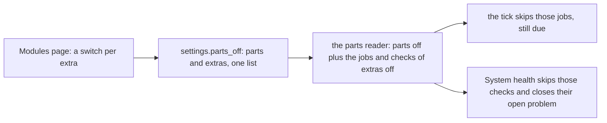

# Optional extras switched off on the Modules page

> **In plain words.** The owner asked that things a portal does not need, like the daily audit
> seal, can be switched off. A core module (Audit log, Access, Backups) could not be switched off
> at all, and with it went everything inside it. Now each core module lists its optional extras on
> the Modules page, each with its own switch. Switching one off stops only that extra's work; the
> module and its data stay. All extras are on until someone switches them off.

## What changed

| Extra | Part | What stops when it is off |
|---|---|---|
| Daily seal (`audit.seal`) | Audit log | the jobs `audit.seal` and `audit.recheck`, the check `audit.sealed`; the log keeps every row |
| Ending access emails (`iam.expiring`) | Access | the job `iam.expiring` |
| Access review reminder (`iam.reviews`) | Access | the check `iam.reviews` |
| Restore drill reminder (`backup.drill`) | Backups | the check `backup.drill`; the nightly copy stays on |

Before, the list held module ids only, and a core module and everything in it was always on.

## Decisions

- **No new setting.** The extras live in the same list as the modules, by their dotted id; the
  list's format accepts `part.name` beside `part`, so a stored list stays valid.
- **The plan's usage measuring is not an extra.** Its readings pause the other jobs when a limit
  is near; stopped, an old reading could hold them paused, so it stays on.
- **A preset sets modules only.** Choosing one on the page keeps the extras as they were saved.
- **Back on, a job runs at once.** A daily seal switched back on seals on the next tick, as a
  module switched back on does.

## Impact on each part

| Part | Impact |
|---|---|
| Client portals | nothing changes until someone switches an extra off |
| `oltrem parts` and the first deploy's question | still switch modules only, and keep the extras as stored (`packages/cli/src/parts.ts`, its catalogue copy holding the same extras) |
| Oltrem Mail | none |

## How it was verified

- `@oltrem/core-config` parts tests: an extra of a core part is accepted, an unknown one refused;
  the reader's set holds the stopped jobs and checks and not the part; the routes list each
  part's extras with their state, save one off beside a part, audit it and switch it back on.
- `@oltrem/core-jobs`: an extra's job waits while its module's other job runs, then runs once on.
- `@oltrem/core-health`: an extra's check stops alone and its open problem closes.
- `@oltrem/cli`: its catalogue equals the kit's, extras included; `writeParts` keeps an extra
  stored by the page when it switches modules.
- `@oltrem/screens`: the extra's switch renders on a core module's tile, checked unless listed.
- The full verify chain; its summary is in the commit.
- Not verified: the page on a phone.
