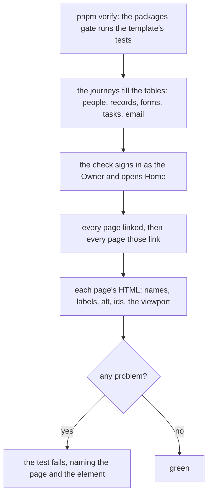

# Phone and accessibility check on every page

> **In plain words.** The rule "phone first" was checked only by people reading the code. Now
> the kit's tests open every page an Owner can reach, about a hundred of them with real rows
> in them, and fail if a button or a link has no name a screen reader can say, a field has no
> label, a picture has no description, the same id is used twice on a page, or the page stops a
> phone from zooming. It found one problem on its first run, in Oltrem Mail's "Add an address"
> dialog, which is fixed. Sizes of tap targets and pages wider than a phone are not checked yet:
> those need a browser inside the checks, which is a new tool for the owner to approve.

## What changed

| Part | Change |
|---|---|
| the client template's tests | `test/a11y.ts`: `checkPage(html)` lists a page's problems; the screens test runs it over Home, every page Home links and every page those link (101 addresses on 2026-11-03), and over its own cases |
| Oltrem Mail | the Add an address field was inside a wrapper that took its label: the field had no name; fixed in oltrem-mail `6c4eff5` and packed into `vendor/mail/` |

How it runs:

Before, nothing failed when a page shipped a button without a name; a screen reader said
"button" and nothing more.

## Decisions

- **In the template's tests, not a separate gate.** The pages need the Worker, its database and
  the rows the journeys make, which only that suite has; the packages gate already runs it. A
  client's own pages are checked the same way in their repository, since the tests come with the
  template.
- **A scan of tags, not a browser.** Preact closes every element and quotes every attribute, so
  the scan is exact for these pages and costs well under a second. Tap sizes and widths need
  layout, so a browser; that is a dependency (R-09) for the owner to approve.
- **Hidden things need no name.** An element out of the accessibility tree (`aria-hidden`,
  `hidden`) is skipped, such as Write's hidden default Send button.

## Impact on each part

| Part | Impact |
|---|---|
| Client portals | none at run time; a client's own page with a nameless button now fails its verify |
| Oltrem Mail | one field fixed; its pages are checked whenever the kit's tests run with Mail mounted |
| The free plan | none |

## How it was verified

- The checker's own cases in the screens test, then the crawl of 101 addresses: one problem
  found (Mail's address field), fixed, packed and green. The full verify chain.
- Not verified: tap sizes, page width, a real screen reader on a phone.
