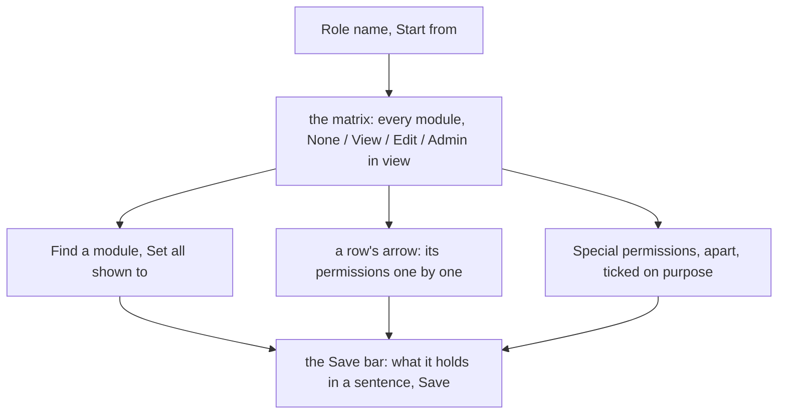
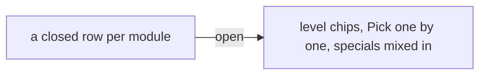

# The role editor as a permission matrix

> **In plain words.** The owner found Users and access confusing: making a role meant opening
> each module one by one to see what it gave, with big buttons inside. Now the whole role reads
> at a glance. Each module is one row with four small choices always in view, None, View, Edit
> and Admin, and the row says how many of its permissions the role holds. A box at the top finds
> a module, and "Set all shown to" sets every row shown in one press. The permissions that need
> extra care (a fresh sign-in, a second person's yes, the Owner role's alone) are listed apart,
> so they are never given by accident. What the role holds stays in a sentence beside Save.

## What changed

| Part | Change |
|---|---|
| `@oltrem/screens` role editor | a row per module with its level chips always in view (a level the module has not is faded and cannot be picked), "Custom · n of m" when the ticks match no level, the arrow that opens its permissions in two columns on a computer; Find a module and Set all shown to above the rows; Special permissions in their own section, grouped by module; the sentence in the Save bar |
| The frame's script | a level ticks its row's boxes, a box moves the chips or leaves none on, Set all respects the filter and takes a row's highest level below the one asked; the sentence counts the special permissions too |
| `@oltrem/core-ui` | `SearchField` with `button={false}` and no name is a filter only; the chip classes `ui-chip-fix` (one width, so the columns line up) and the faded chip; `ui-part-more`, the row's arrow |

How a role is set now:

Before, each module was a closed row; its level and its permissions were inside it:

## Decisions

- **The same form as before.** Each row still posts `level:<module>` and `was:<module>` and its
  boxes, so the server's reading of a role (`chosenCapabilities`) is unchanged and the page works
  without its script. "Custom" is no longer a chip: no chip on means the boxes count.
- **Four columns on every row.** A missing level is shown faded rather than left out, so the
  chips line up and a module that has no Admin says so.
- **Set all acts on what is shown.** Find narrows the rows, then one press sets them: "every
  sales module to Edit" is two steps.
- **Room.** The stylesheet stays inside its 64 KiB test (65,071 bytes after this change); no
  new dependency.
- **Not yet:** a person's own page as the same matrix, read-only with where each permission
  comes from; the palettes; the arrangement of the other pages.

## Impact on each part

| Part | Impact |
|---|---|
| Client portals | the next kit update; no migration, no stored change |
| Oltrem Mail | none: its permissions appear as rows like any module's |
| The free plan | none: the same reads and the same form |

## How it was verified

- Tests: the frame's script (a level ticks its row, a box moves the chips, Custom, a special
  counted, Set all with a level a module has not, a hidden row left alone), core-ui's filter-only
  search field, the client template's role editor (the matrix's words, the level checked after
  a save, Custom with no chip on).
- Driven in Chromium at 390 px and 1366 px on the local portal: Set all shown to Admin under a
  filter, a row opened and a box unticked, the sentence following.
- The full verify chain.
- Not checked: the owner's phone (P37).
