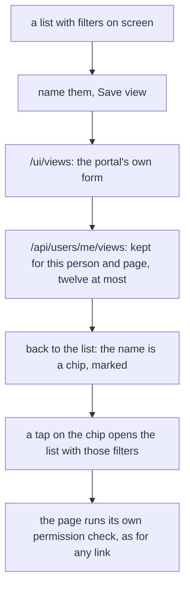

# Saved views

> **In plain words.** On a list (tasks, files, customers, a records list, a form's inbox, the audit
> log), the filters someone uses often can now be kept under a name: "Open work", "North, this
> folder". The names sit as a row of chips above the list, and one tap brings the filters back.
> Each person keeps their own, up to twelve per page. A view keeps only the filters, never the
> rows, so it can never show someone more than the list itself would. It is the open-source
> ideas' R1, the owner's pick of 2026-11-03.

## What changed

| Part | Change |
|---|---|
| `@oltrem/users` | migration `0055`: `users_views`; routes `GET`, `POST /me/views` and `DELETE /me/views/:id` under `users.self`; `KIT-E-2103` past twelve on a page |
| `@oltrem/core-module` | a page may declare `views`, the query parameters a saved view keeps; a page's own state (`done`, `page`) is refused |
| `@oltrem/screens` | the row of saved views above such a page, Save view and Remove, the posts `/ui/views` and `/ui/views/remove`; the kit's records lists, form inboxes and audit log keep views |
| tasks, files, customers | their list pages declare their filters |

How a view is saved and opened:

Before, the filters lived only in the address: to see the same list again, a person filtered again
or kept a browser bookmark, which a phone hides away.

## Decisions

- **The filters, never the rows.** A view is an address; the list is read again when it opens.
- **Personal first.** Shared views (for a team or a place) wait: they need a rule for who may
  change a view others use. The table can take a place column then, additively.
- **Opt-in per page.** Only a page that declares its filters shows the row, so a form or a detail
  page never offers to "save a view" of a draft. The page's own state (`done`, `page`) is never
  kept.
- **Cost.** One D1 read per list page that keeps views, one write per save or removal; no KV.
- **Not audited**, like the theme: it changes nothing anyone else sees.

## Impact on each part

| Part | Impact |
|---|---|
| Client portals | migration `0055` applies with the next template update; the row shows on the six lists |
| Oltrem Mail | none yet; its lists may declare `views` later |
| The free plan | one read per such page view, one write per save |

## How it was verified

- Tests: users (each person's own views, a name replaces, twelve then `KIT-E-2103`, another
  person's id removes nothing, a path outside the portal or a query with a fragment refused),
  core-module (`views` checked), the client template (save, the chip on the bare list, marked when
  open, remove, the audit log, a form from another site refused), Home and every sidebar page
  still inside their query share. The full verify chain.
- Not verified: the row on a phone, a portal on Cloudflare (no sandbox yet).
