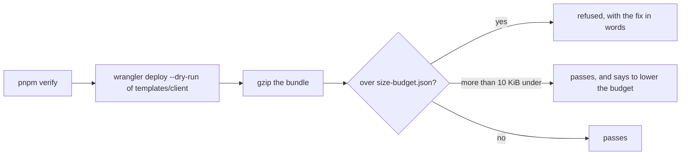

# The client Worker's size held to a budget

> **In plain words.** Each time a portal wakes up, Cloudflare first reads all of its code, and on
> the free plan that reading comes out of the same 10 ms of work a page is allowed. The portal's
> code had no limit: any change could make every portal slower to wake without anyone noticing.
> Now `pnpm verify` builds the portal the way a deploy does, measures it, and refuses a change
> that makes it bigger than its budget. The budget only goes down.

## What changed

| Part | Change |
|---|---|
| `size-budget.json` | the budget per Worker, in KiB compressed: `templates/client` 500 |
| `scripts/lib/size.mjs`, `scripts/check-size.mjs` | build with wrangler's dry run into a temporary folder, gzip the output, compare |
| `scripts/lib/gates.mjs` | the `size` gate, after `manifest`; [what verify runs](../reference/verify.md) regenerated |

Before, nothing measured the bundle; `oltrem upgrade` only checked Cloudflare's own hard limit.

## Decisions

- **Compressed size** is what Cloudflare counts against a Worker's limit and what a cold start
  reads; it was 492.4 KiB on 2026-11-03, so the budget is 500.
- **Wrangler is started with this Node** (its `bin/wrangler.js`), never by name, so the gate runs
  on Windows too.
- **Raising the budget** needs the owner's yes and the reason in the commit; the gate's message
  says so.

## How it was verified

- `node --test scripts/size.test.mjs`: 3 pass (over refused with its fix, well under noted with
  the figure to lower to, no budget refused).
- `node scripts/check-size.mjs`: 492.4 KiB of 500, in about 4 s.
- The full verify chain; its summary is in the commit.
- Not done: making the Worker smaller, which is K2's second half.
