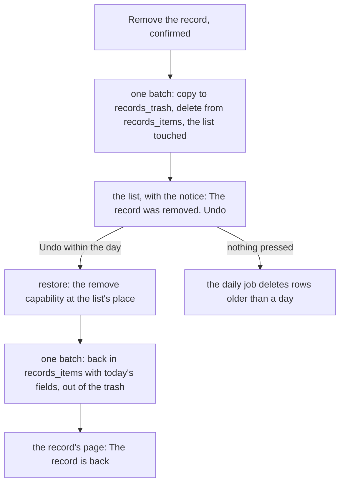
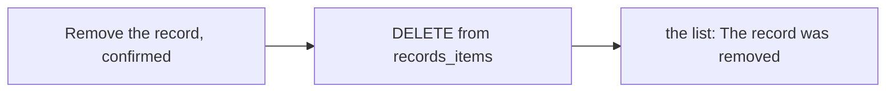

# Undo after removing a record

> **In plain words.** Removing a record in one of the company's lists used to be final: a slip of
> the thumb on a phone lost it. Now the notice that says "The record was removed" carries an
> **Undo** button for the six seconds it shows (longer while a finger or the pointer rests on it).
> A press puts the record back exactly as it was. Behind the scenes the record waits a day in a
> trash table, and a daily job deletes it for good after that. It is the open-source ideas' R4,
> built on records first.

## What changed

| Part | Change |
|---|---|
| `@oltrem/records` | migration `0057_records_trash.sql` (`records_trash`); a removal copies the row there in the same batch; `restoreItem` and `POST /api/records/lists/:id/items/:item/restore` (`records.remove`); the daily job `records.trash-prune`; removing a list empties its trash rows |
| `@oltrem/screens` | the removal's notice carries Undo (a form, so it works without the script); `/records/:id/items/:item/restore` comes back to the record with "The record is back, as it was."; the confirmation no longer says it cannot be undone |
| `templates/client` | the kit's migration copied in, `kit.json` and the generated migrations page |

How a removal and its Undo travel:

Before, the removal was one `DELETE` and nothing could bring the record back:

## Decisions

- **A trash table, not a column.** `records_trash` is a new table made with
  `CREATE TABLE IF NOT EXISTS`, so the migration stays additive and idempotent, and no query of
  the records changes: a removed record is simply not in `records_items`.
- **One day.** Long enough for any Undo, short enough that a removed record does not linger;
  `TRASH_HOURS` in the store. The job is one query a day.
- **The same rule as the removal.** Undo needs `records.remove` at the list's place; a person who
  cannot see the list gets the same "not found" as for any record there.
- **Today's fields.** A field removed since the record was removed is left out on its way back,
  and the search text is written again, so Undo never brings back a value the designer removed.
- **The record's own id comes back,** so links to it work again and its audit history joins up.

## Impact on each part

| Part | Impact |
|---|---|
| Client portals | one new table with the next template update; the migration runs before the new code |
| Personal data | a removed record is kept one more day, then deleted for good |
| The free plan | one more D1 write per removal, one read and one batch per Undo, one query a day for the job; no KV |
| Oltrem Mail | none |

## How it was verified

- `modules/records`: a record removed is gone from its list and the search; Undo by a person
  without the place is refused; Undo puts it back with its values and search; a second Undo is
  refused; past its day Undo is refused and the job deletes it; the audit has
  `records.item-restore`; the manifest names the job and both migrations.
- `templates/client`: the removal's notice carries the Undo form, and Undo brings the record back
  with its saved value; a list removed afterwards empties its trash.
- In Chromium at 390 px on the local portal: Remove, then Undo on the notice, back on the record's
  page with its value.
- The full verify chain; its summary is in the commit.
- Not done: Undo on other modules' removals (tasks, files have their own trash already); a bulk
  remove of records, which does not exist yet.
