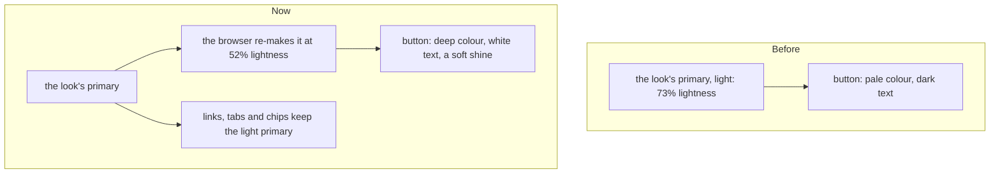

# Colour pass

> **In plain words.** The owner's phone screenshots of Email showed a dark theme whose main
> buttons were a pale lilac with dark text, fields the same grey as the cards around them, and a
> background with hardly any colour. Now a main button is a solid, deeper colour with white
> text and a slight shine, the way Gmail, Linear and Stripe draw theirs; a field is a shade
> darker than its card, so it reads as a place to type; and the dark background carries more of
> the portal's colour. Every one of the 24 looks follows, since the button's colour is worked out
> from the look's own. The owner said yes to giving the stylesheet up to 80 KiB for this pass
> (it was held to 64 KiB).

## What changed

| Part | Change |
|---|---|
| `@oltrem/core-ui` | Three new colours: `fill` (a main button, a switch that is on, a count badge), `fill-fg` (the text on it) and `field` (a text box's background). In light they are the primary, white and the card's white. In dark, `fill` is the primary at 52% lightness with white text, worked out by the browser from whatever the primary is (`oklch(from ...)`); a browser without that keeps the light primary with dark text, as before. `.ui-fill` gives a main button a soft top light and a small shadow. The dark background's washes of colour are 16% and 12%, not 9% and 7%. A switch's knob is near-white |
| `@oltrem/screens` | Each look's dark greys include its own `field`, so a field leans to the look's tint like its cards. The stylesheet test allows 80 KiB (the owner's yes, 2026-11-04) |

How a main button gets its colour in the dark:

Before, one colour did two jobs in the dark: text and links needed it light, so the button on it
was light too and its text dark. Now the button has its own colour, so links stay light and
readable while buttons are solid.

## Decisions

- **52% lightness, tested for every hue.** White text on the fill reads at 4.5:1 or better for
  every hue (0 to 350 degrees in steps of 10) and the strengths the looks use; at 54% a green
  fell to 4.48, so 52% it is.
- **Gated on the browser.** Relative colours are behind `@supports`, because a browser that does
  not know them would make the button transparent rather than fall back.
- **The cap is raised, not removed.** 80 KiB is what the owner allowed; the test still fails
  above it. The kit review's K8 said the limit is kept: it is, at its new size.

## Verified

- `pnpm verify`: see the commit.
- core-ui tests: the new colours compile; white on the fill at 4.5:1 for every hue and strength;
  the dark theme is the same through the switch, a class and the device; the button's classes.
- Screens and the client template: the stylesheet carries `.bg-fill`; the role editor's one
  primary button.
- Screenshots at 390 px, dark and light, of Email Write and Templates, Home and Settings.

Not verified: a real phone (P59 in [the phone tests](../phone-tests.md)); a browser without
relative colours (older Safari before 18, Firefox before 128), which keeps the earlier look.
