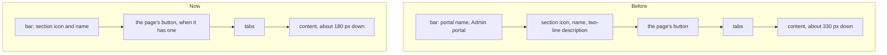

# The phone's top

> **In plain words.** On a phone, the top of every page was said three times: the portal's name in
> the bar, then the section's icon, name and a two-line description, then the tabs. That took
> about 40% of the screen before any content (the owner's screenshots of Email, Write and
> Templates). Now the bar itself names the page, with the section's coloured icon, the way phone
> apps do (Material's top app bar, Gmail, Linear), and the page gives up the rows that repeated
> it. The tabs sit right under the bar and the content starts about 150 px higher. A computer is
> unchanged.

## What changed

| Part | Change |
|---|---|
| `@oltrem/screens` | The phone's bar is 52 px, not 60: Menu, the section's coloured icon and the set's or section's name, Search and Notifications. The portal's name and "Admin portal" stay in the drawer. A page head whose heading says the same as the bar carries `data-bar` |
| `@oltrem/core-ui` | Below 1024 px a `data-bar` head keeps only its actions: its heading stays for screen readers (clipped, not removed), its icon and description go, and a head with no actions takes no room. The page starts 12 px under the bar, with 16 px between its parts |

What a phone shows above the content:

A record inside a section (a message, a list) keeps its own heading under the tabs, since the bar
names the section and not the record.

## Decisions

- **The heading is kept, clipped.** Screen readers and the accessibility check still find one
  `h1` per page.
- **Colour comes next.** The stylesheet is at 65,486 bytes of its 65,536 test after this step (with Mail's new switch), so
  the colour and surface pass the owner asked for waits on their answer about more room.
- **Mail's own controls** (Write's Words and HTML switch) belong to the Mail add-on.

## Verified

- `pnpm verify`: see the commit.
- Screens tests: the bar names the section on its page and on a record inside it; the head is
  marked only when it repeats the bar.
- Screenshots at 390 px, dark and light, of Email Write and Templates, Users and Records, before
  and after; the computer's 1366 px unchanged.

Not verified: a real phone (P58 in [the phone tests](../phone-tests.md)).
