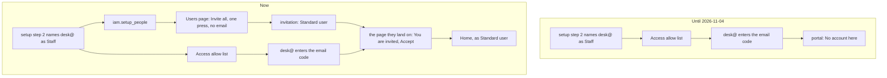

# The people named at setup get in

> **In plain words.** Step 2 of the setup, "Who signs in", lets you list people and mark each as
> Owner, Staff or Your team. Until today that list only opened Cloudflare's door: each person
> could enter the email code, but the portal had no account for them and answered "No account
> here". Now the list also reaches the portal. Home's Get started says "Invite the 3 people named
> at setup", and the Users page invites them all in one press, each to the role setup gave them:
> Owner as Owner, Staff as Standard user, Your team as Full admin. No email is sent and no link is
> needed: each person opens the portal, enters the code Cloudflare emails them, and presses Accept
> on the page they land on. The owner chose this ("Invite them automatically", then "you don't
> have to send emails, as long as that user can log in").

## What happened

| When (UTC) | What |
|---|---|
| 2026-11-04 06:45 | The owner asks to check step 2: the people it names must be able to sign in |
| 2026-11-04 07:02 | The cause: step 2 wrote the people to the door's allow list only, so they got past Access but had no account. The owner picks "Invite them automatically" |
| 2026-11-04 07:06 | The owner: no emails needed, as long as each person can log in |

The door was right: the Vendor, every active person, every pending invitation and each entry of
step 2 are on the Access allow list (`@oltrem/iam`, the door). What was missing was the portal
account, which only an accepted invitation makes, and accepting needed the link from an email.

## What changed

| Part | Change |
|---|---|
| `@oltrem/iam` | A setting, `iam.setup_people` (each line `address owner\|staff\|team`, set by the Vendor). `GET /setup-people`: the ones still without an account or a pending invitation. A Get started step on Home. `POST /invitations/accept` takes no token and then uses the newest invitation waiting for the signed-in address. `POST /invitations/mine` tells the signed-in person what waits for them, never the token |
| `@oltrem/screens` | The Users page lists "Named at setup" with each person's role and one button. The press makes a missing Standard user or Full admin role from its ready set, then invites everyone at the company with no email. A signed-in person with no account who has an invitation sees "You are invited … as Standard user" and an Accept button |
| `@oltrem/cli` | `npm run deploy` writes each person step 2 names to `iam.setup_people` beside the door's list, keeps the role chosen last time, and its closing lines say to create the company, then press Invite on the Users page |

How a person named at setup gets in:

## Decisions

- **Accept with no link is as safe as the link.** The link's token only finds the invitation; the
  check that matters is that the signed-in address is the invited one, and Access proved that
  address with its email code. Someone with nothing waiting is refused ("no invitation waits for
  this address").
- **One press, not automatic.** The invitations are made by a person on the Users page, under the
  same grant rules as any invitation, so the record names who invited. Before the handover the
  Vendor alone invites Owners; after it, another Owner needs a second person as always, and the
  press says so by name instead of making it.
- **Roles from the ready sets.** Staff and Your team become Standard user and Full admin, made
  from the role editor's ready sets the first time they are needed, so they can be changed later
  like any role.

## Verified

- The template, end to end through the local door (`test/setup-people.test.ts`): the setting
  saved and a wrong line refused; Home's Get started step; the Users page listing three people
  with their roles; one press making three invitations and two roles with no email; nobody offered
  twice; a Staff person signing in, seeing "as Standard user", accepting and landing on Home with
  an account; the first Owner accepting without a link; a later Owner refused for want of a second
  person; a stranger refused.
- The IAM routes: accept without a token refused for someone with nothing waiting;
  `/invitations/mine` naming the company and the role, or `null`.
- The command-line tool: step 2 writes `iam.setup_people`, keeps the roles on the next run, and
  empties it when the people are taken off the list.
- `pnpm verify`: see the commit.

Not verified: the live portal (phone test P61).
