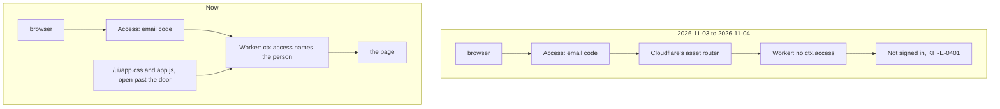

# Sign-in refused on a live portal

> **In plain words.** On 2026-11-04 the owner could not get into their live portal: Cloudflare's
> door asked for the email code as usual, then every page answered "Not signed in" (KIT-E-0401,
> "The request carried no identity from the Access door"). The cause was a kit change of the day
> before: the portal's stylesheet and script had moved to Cloudflare's static files. Cloudflare
> puts a Worker with static files behind its own router, and that router does not pass the
> sign-in on to the Worker. Access still let people through; the portal just could not see who
> they were. The Worker serves the two files itself again, the way it did until 2026-11-03, and
> the deploy now refuses static files, so this cannot come back. The owner chose this fix.

## What happened

| When (UTC) | What |
|---|---|
| 2026-11-03 07:17 | Look 2, step 1 moved `/ui/app.css` and `/ui/app.js` to static files (`"assets"` in `wrangler.jsonc`); `oltrem deploy` and `oltrem upgrade` added the line to every client |
| 2026-11-04 06:40 | The owner, on the live portal: Access lets them in, then every page answers KIT-E-0401 |
| 2026-11-04 06:42 | Cause confirmed in Cloudflare's documentation: "When a Worker has Static Assets, the internal assets router does not pass `ctx.access` to the user Worker" (Workers, Cloudflare Access, `ctx.access` limitations). The owner picked the fix: the Worker serves both files |

The portal trusts only the runtime's own record of the sign-in, `ctx.access`, never a header
anyone could send (`@oltrem/core-http` README, "identity"). That README already said a Worker with
static assets does not get it, and that a client's Worker has none. The tests hand the Worker a
`ctx.access` directly, so no test could see the router that a deployed Worker gets.

## What changed

| Part | Change |
|---|---|
| `@oltrem/screens` | `publicRoutes` serves `/ui/app.css` and `/ui/app.js` again, before the door, cached for good under their version and `no-cache` without it, with `nosniff`. `pnpm ui:build` writes them to `src/generated/assets.ts`; `public/` and its `_headers` are gone |
| `@oltrem/cli` | `withoutAssets` replaces `withAssets`: `oltrem deploy` and `oltrem upgrade` take the kit's `assets` line (and its comment) out of a client's `wrangler.jsonc`; any other `assets` stops the deploy, and the upgrade reports it |
| `templates/client` | `wrangler.jsonc` has no `assets`, with a comment saying why |
| Size | The Worker is 506.4 KiB compressed with the two files in it; its budget goes from 500 to 520 KiB (the owner's yes, 2026-11-04). Cloudflare's free plan allows 3 MiB |

How a page reaches the portal:

## Decisions

- **The Worker serves the files, the sign-in is untouched.** The other way, reading Access's
  signed token from a request header and checking it, would have kept the files outside the
  Worker but changed how the portal decides who someone is. The owner picked the way that leaves
  the sign-in exactly as it was when it worked.
- **Refused for good.** A client who adds static files of their own would break sign-in the same
  way, so the deploy stops on any `assets` and says why.
- **Setup step 2 checked.** The owner asked whether "Who signs in" lost people. It does not: the
  Vendor, every active person, every pending invitation and every entry of step 2 are on the
  Access allow list, which the Worker keeps in step (`@oltrem/iam`, door). Getting past the email
  code proved the list let the owner in.

## Verified

- `pnpm verify`: see the commit.
- The client template: both files answer before the door, `no-cache` without the version and
  cached for good under the version each page links, with `nosniff`; the stylesheet carries the
  screens' classes and the script the frame.
- The command-line tool: the template has no `assets`; the kit's line, with or without its
  comment, comes out of an older configuration and leaves exactly the template; any other
  `assets` is refused.
- The size gate: 506.4 KiB of 520.

Not verified: the live portal after the owner's update (the steps are in the commit's report);
Cloudflare's router itself, which no local test runs.
