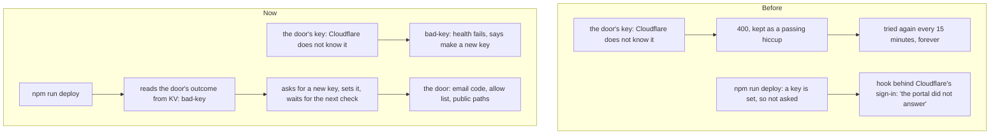

# A key Cloudflare does not know

> **In plain words.** A live portal let in nobody it had invited. Its Cloudflare sign-in page
> offered only "Cloudflare" (members of the Cloudflare account), so the Vendor was turned away
> and the account's owner got in with no account in the portal. The portal keeps that page right
> by itself, with its own key, and Cloudflare did not recognise the key at all. The portal filed
> that as a passing hiccup, tried again every quarter of an hour, and the deploy never asked for a
> new key, because one was set. Now the portal names it ("Cloudflare does not recognise the
> portal's key"), the deploy asks for a new one and waits until the portal uses it, and a new key
> is used on the portal's next check instead of after the old refusal runs out.

## What happened

| When (UTC) | What |
|---|---|
| 2026-11-05 14:57 | The owner: the Vendor reads "Application authorization failed" at the door; the client's owner gets in and reads "No account here" |
| 2026-11-05 17:55 | Read on the owner's computer: the door's outcome in KV says `GET /organizations: HTTP 400: Authentication failed`, never synced; the sign-in page has one login, "Cloudflare", and no email code; `/healthz` and `/hooks/iam/door` are behind it too |

Cloudflare answers 400 "Authentication failed" (code 9106) to a key it does not know: deleted,
rolled, or something else pasted. A key it knows that lacks a permission gets 401 or 403. The
door's first call failed every time, so it never added the One-time PIN login, never made the
allow list, and never opened the public paths. The deploy could not ask the portal (its hook was
behind the same page) and, since a key was set, never checked it again.

## What changed

| Part | Change |
|---|---|
| `@oltrem/iam`, the door | A new outcome, `bad-key`, for Cloudflare's 400 "Authentication failed", "Invalid API Token" and an unreadable Authorization header; the health page fails with what to do. It is tried hourly, and the key is part of the outcome's hash (one way, 8 bytes), so a new key is used on the next tick (five minutes) |
| `@oltrem/cli`, the deploy | When the hook does not answer, the outcome the tick kept in KV is read all the same. `bad-key` asks for a new key as a key without Access permission does, sets it, and waits until the portal has used it |

## Verified

- The door against an in-memory Access API (`modules/iam/test/door.test.ts`): a 400 with code
  9106 is `bad-key` with Cloudflare's words; on the tick it fails the health page, waits the
  hour, and a new key syncs on the next tick.
- The command-line tool (`packages/cli/test/door.test.ts`, `deploy.test.ts`): the outcome is read
  from KV when the hook answers a redirect to Cloudflare's sign-in or nothing; a deploy whose door
  says `bad-key` asks for a new key, sets it, waits for the portal, then reports the door set.
- `pnpm verify`: see the commit.

Not verified: the live portal with the new key (phone test P62).
