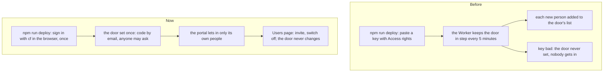

# The door with no key

> **In plain words.** Cloudflare's sign-in page in front of each portal (the door) used to be
> kept up to date by the portal itself, with a key it held: each new person had to be added to
> the door's list. When that key went bad, nobody could get in, and looking after keys across
> many client portals is upkeep nobody wants. Now the door is set once, when the portal is put
> on Cloudflare, with Cloudflare's own sign-in in the browser (as wrangler's is), and no key is
> made or kept for it. The door lets anyone ask for a code by email; the portal then lets in only
> its own people, and tells anyone else "No account here". So the door never changes when people
> come and go: the Users page alone decides who gets in.

## Why

The owner's decision of 2026-11-05, after a live portal let in nobody: the portal's key was one
Cloudflare did not know ([the record](2026-11-05-dead-key.md)). He asked for the door with no key
at all, "token management is a hassle in the long run, with multiple clients". wrangler's sign-in
cannot reach Zero Trust, so the deploy could not set the door with it. Cloudflare's newer command
line, `cf`, signs in the same way and can: the owner chose to add it (a decision card, 18:44 UTC).

The cost, said on the card: anyone may ask for a code, and each person who signs in at the door
takes one of Zero Trust's 50 free seats for at least a month, while they see nothing of the
portal past "No account here".

## What changed

| Part | Change |
|---|---|
| `@oltrem/iam` | The module keeps no door: the `iam.door` job, health check and hook, the `iam.door_worker_id` and `iam.door_extra_emails` settings and the `door` option are gone; `settings` feeds the Users page's one-press invite (`iam.setup_people`, now in `src/setup-people.ts`). Settings already stored under the old keys are left alone and shown as unused |
| `@oltrem/cli`, the deploy | Step 6 sets the door with cf (`setDoor` in `src/door.ts`): Zero Trust set up, the One-time PIN login, one policy that includes everyone, the Access application on the Worker with the open paths. cf signs in once on the computer (`cf auth login --no-device`); a refusal asks for a sign-in again; Zero Trust not set up shows its one step and waits. When cf cannot set it, the reason and the steps by hand |
| `@oltrem/cli`, step 2 | "Who else will use the portal?": addresses with a role, for the Users page; a whole `@domain` is refused, since the portal invites people one by one |
| The key, `KIT_OPS_TOKEN` | Two permissions (D1 Edit, Account Analytics Read), no Access ones. It still serves the nightly copy and the usage figures; those move off keys later |
| The client template | `cf` pinned in its tools (1.0.0-beta.19, from 2026-10-20, the newest that runs on the kit's Node 22.12; dependency registry row) |

Each service: the client's Worker holds no Access right and calls no Access API; the deploy, on
the person's computer, calls Cloudflare's Access API through cf; Cloudflare's Zero Trust holds
one policy and one application per portal, as before, set to everyone instead of a list.

## Verified

- The door against an in-memory Zero Trust answering as cf prints (`packages/cli/test/door.test.ts`):
  a fresh account gets the login, the policy and the application with the five open paths, and a
  second run writes nothing; the dashboard's one-click application is edited in place (its
  audience kept, the other Worker's untouched, another application on the address named); no Zero
  Trust, signed out, refused and Cloudflare failing are each said, nothing thrown.
- The deploy (`deploy.test.ts`): cf's sign-in in the browser, the three parts made, the account
  named; cf already signed in asks nothing; Zero Trust's step then Enter; a refused sign-in asked
  again with `--force`; without cf or the Worker's id, the steps by hand and the run goes on; the
  people list with roles and a domain refused.
- cf itself, on this computer with no account: `cf cli search` found the commands, and
  `--dry-run` showed each one's request (the same Access API paths the Worker used before).
- `@oltrem/iam`: the module keeps no door (`sign-out.test.ts`); the template's Worker and screens
  tests.
- `pnpm verify`: see the commit.

Not verified: cf's sign-in and the door set on a real account (the live portal, phone test P63);
Cloudflare's consent page for cf's default permissions; Windows.
