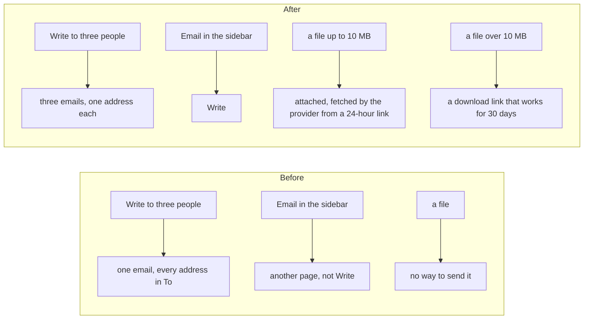

# Email reworked for the client

> **In plain words.** The first client tested Email, the part they are buying the portal for, and
> listed nine problems on 2026-11-08. This record covers what the kit took in from Oltrem Mail
> that day. When an email goes to several people, nobody sees the others. Email opens on Write.
> Write's email looks right in every inbox. Files can be attached, and a campaign can send each
> person their own file. A file over 10 MB goes as a download link. Campaigns follow four steps.
> Email's settings have their own entry in the sidebar, and its errors use plain words. The new
> look of the portal and the Gmail-like screen are separate work.

## What changed

- **Privacy.** Write with several people in To sends one email to each person. Cc and Bcc go
  only with the first copy. The automations' "Send an email" also sends one email per address.
  Campaigns already sent one email per person.
- **Write first.** Email in the sidebar opens Write, then Inbox, Drafts, Sent and Templates.
- **Write's email.** Write makes email-safe HTML with the styles written into each tag. A
  whole email pasted in goes as its own page, never nested in another. The preview shows what
  the person will receive.
- **Files.** Write and campaigns attach PDFs, Office documents, pictures, text and ZIP files,
  up to 10 MB together, through Brevo or Resend. The provider fetches each file from a link that
  lasts 24 hours, and the link is stored only as its hash. A campaign can send one file to
  everyone or each person their own file, matched by the address in the file's name or by a
  column of the list. A file over 10 MB, up to 95 MB, is never attached: the email ends with a
  link to download it that works for 30 days, so any provider can carry it. The page sends a
  large file straight to its route (`data-upload` in `frame.js`), never through the form.
- **Campaigns.** A draft shows four steps (who gets it, what it says and from whom, check it,
  when it goes), each done or naming what it needs. A campaign set for later can go back to a
  draft until it sends to anyone, and the list has a Scheduled stage.
- **Email settings.** Connecting a service, Addresses, Integrations, Mail setup and Forwarding
  are the tabs of one sidebar entry, Email settings. The errors staff read most often no longer
  use the words of the code.
- **Gmail-like inbox.** The inbox is laid out like Gmail, using the kit's `MailShell` and
  `ConversationRow`. On a computer it shows the folders with Compose on top, the list, and the
  open conversation beside it. On a phone the folders are a row of chips, Compose is a round
  button, and a conversation fills the screen, with a way back to the same list.
- **Size.** The client Worker's budget went from 520 KiB to 1024 KiB gzip, with the owner's yes
  on 2026-11-08. The Worker was at 519.9 KiB after this work.

Two migrations were added to the template: `1010_email_files` (the files and their links) and
`1011_email_files_owner` (a file's campaign and person). There is a new hourly job,
`email.files`, which clears expired links and files. No binding, variable or key was added:
the files go in the portal's one bucket.

## Before and after

Each service: the client's Worker does all of this in its own database and bucket. Brevo and
Resend fetch attachments from the Worker's link. Other providers, SMTP and batch sends carry no
attachments, so a campaign with files sends one message per call.

## Verified

- Oltrem Mail's tests (`modules/email`, `modules/campaigns`, `modules/mail`): one email per
  person, files and their links, per-person matching, download links, the four steps, back to
  a draft, the Email settings tabs, and the plain-word errors.
- The kit: `packages/providers` (attachments for Brevo and Resend, refused elsewhere),
  `packages/screens/test/frame.test.ts` (a file box sends straight to its route), and the
  template's worker and screens tests (the `email.files` job, the migrations).
- Not verified: these on a phone (P69, P70 and P75); Sent still shows only the first copy of an
  email sent to several people.
- `pnpm verify`: see each commit.
