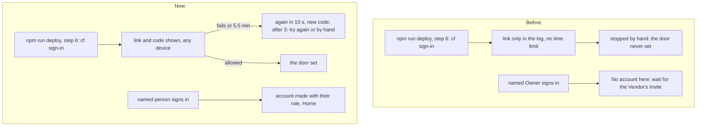

# First run: named people get in, Cloudflare's sign-in tries again

> **In plain words.** On a new portal nobody could get in. The deploy stopped while waiting for
> Cloudflare's sign-in, which showed no link and never gave up, so the door was never set; and the
> person the deploy had named could pass Cloudflare's old door but had no account in the portal,
> since only the Vendor can invite. Now Cloudflare's sign-in shows its link and code (open it on
> any device, a phone too), gives up after five and a half minutes, starts again by itself ten
> seconds after a failure, and after three tries asks whether to try again or set the door by
> hand. And the people named at setup get their account, with their role, the first time they
> sign in: nobody has to press Invite.

## Why

The owner's live deploy (2026-11-08, Windows) waited at "Waiting for you in the browser
(Cloudflare's sign-in for the door)" until he stopped it, several times: he asked for it to "auto
trigger it again, retry after 10 seconds of fail". cf's localhost sign-in printed its link only
to the deploy's log, and the look's spinner hid it, so with no browser in front there was nothing
to click. The portal itself was working: its page said "No account here" to the address the
deploy had named as Owner, because being named was not an account until the Vendor pressed
Invite, and Cloudflare's old door still refused the Vendor. He chose, on a decision card
(07:29 UTC), that people named at setup get in on their first sign-in, no Invite press needed.

## What changed

| Part | Change |
|---|---|
| `@oltrem/iam` | A signed-in address with no account at all, named in `iam.setup_people`, gets its account at the whole company with the role setup gave (`handover.admitNamed`, asked by the session hook through the new `admit` option): the Owner role, or Standard user and Full admin found by name or made from their ready sets. Refused, with why, when there is no company yet (the Vendor is named), for an Owner after the handover, for anyone after it unless the Vendor may enter at any time; an invitation already waiting is accepted as before. Home's Get started now reads "The 3 people named at setup sign in" |
| `@oltrem/cli`, the door | cf's sign-in is its device flow (`cf auth login`): a short link and a code, shown as printed (the look's `QUESTION` lets them through; the setup page shows each new link as a button), the browser opened on them. One try stops after `CF_SIGN_IN_MS` (5.5 minutes); the deploy tries again 10 seconds after a failure, three times, then asks: try again, or skip to the steps by hand |
| `@oltrem/cli`, step 2 | The terminal takes a role's word after an address (`name@example.com owner`): before, the word became an entry of its own and stopped the deploy. A row with no role keeps the person's role instead of dropping to Staff |
| `@oltrem/cli`, the look | `runTool` takes `timeout` (a run still going is stopped, a failure that says so); once a tool's output was shown to the person, a failure does not print its lines again |
| `@oltrem/screens` | The Users page's "Named at setup" says each one gets in at their first sign-in; its one-press Invite stays |

Each service: the client's Worker makes the account at sign-in from its own setting and tables (no
new binding, table or variable); the deploy, on the person's computer, runs cf as before, with a
time limit and tries; Cloudflare Access is unchanged.

## Verified

- `@oltrem/iam` (`modules/iam/test/setup-admit.test.ts`): before the company, refused naming the
  Vendor; Standard user made from its ready set (View and Edit, no special permission), granted
  by the Vendor, "named at setup"; the Owner as the first Owner, the handover stamped; Full admin
  after the handover; signing in again makes nothing twice; another Owner after the handover, and
  anyone once the Vendor's access is `approval`, refused with why; a stranger and an address with
  an invitation waiting are not let in this way. The 10 iam test files pass.
- The template, through the local door (`templates/client/test/setup-people.test.ts`): a person
  named and not invited lands on Home at the first sign-in; the one-press Invite and Accept still
  work as before.
- The deploy (`packages/cli/test/deploy.test.ts`): `cf auth login` with the time limit; two lapsed
  sign-ins, then the third 10 seconds later; three lapsed, the question, try again; three lapsed,
  skip, the steps by hand; a bare address keeps its role. The terminal's list with roles
  (`parts.test.ts`), the look's time limit and no second printing (`look.test.ts`), the setup
  page's links from a sign-in tried twice (`setup-page.test.ts`).
- cf 1.0.0-beta.19 read here: the device flow prints "please visit", the link and the code, opens
  the browser on the link with the code, and gives up when the code expires (at most five minutes).
- Not verified: cf's device sign-in on a real account and on Windows (P64); a live portal letting a
  named person in (P64).
- `pnpm verify`: see the commit.
