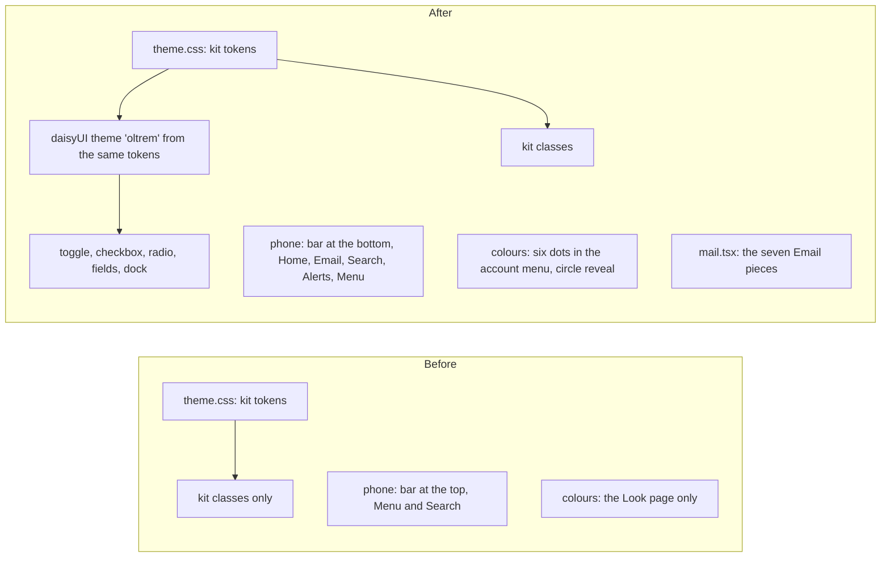

# Look 3, wave 1: the foundation

> **In plain words.** The client said the portal looked and felt poor. This is the first of four
> waves that rework every page. It lays the ground the others build on: ready-made controls
> (switches, tick boxes, fields) from daisyUI, coloured by the portal's own colours so every
> look and dark mode still apply; a bar along the bottom of a phone, where the thumb reaches;
> six colour dots in the account menu that repaint the portal in a circle spreading from your
> finger; a toast that shows how long it stays; and the pieces the Email screens will be built
> from, drawn the way Gmail and Outlook draw theirs. The owner chose daisyUI, the mixed style
> and the bottom bar on 2026-11-08 ("do everything").

## What changed

- **daisyUI, inside the kit's stylesheet.** A Tailwind plugin run only when the stylesheet is
  built: CSS only, no script reaches the browser, zero dependencies of its own. Only the parts
  named in `theme.css` are taken. Its one theme, `oltrem`, is filled from the kit's tokens
  (`base-100` the surface, `primary` the fill, the tones from ok, attention, danger and info), so
  `looks.ts` stays the one colour list. The switch is daisyUI's toggle; tick boxes and choices
  are its checkbox and radio; the fields carry its classes beside the kit's own. Its rules sit in
  a layer inside Tailwind's utilities, so the kit's rules that must win live in
  `@layer utilities`.
- **The phone's bar moves to the bottom.** Home, Email (when the portal has it), Search, Alerts
  with the unread figure, and Menu (the same drawer as before). The top bar is gone; each page's
  own heading names it again, without its icon and line.
- **Colours from the account menu.** Six dots (indigo, emerald, ocean, sunset, rose, graphite)
  post to `/ui/look`, which now keeps the background already chosen. With the script, the new
  colours, and a change between light and dark, spread as a circle from the button (a view
  transition, 450 ms); with reduced motion or an older browser the page just changes.
- **Motion.** A button presses to 96 % instead of 98 %; a toast draws a line that drains over
  its six seconds and stops while a finger or the mouse is on it.
- **The Email pieces** (`src/mail.tsx`): `MailShell`, `ConversationRow`, `ComposeSheet`,
  `SidePanel`, `ProblemCard`, `SaveBar`, `UndoToast`, with their styles. The frame's script
  raises a `SaveBar` once its form has changes. The Email thread wires them into its screens.
- **The stylesheet** grows from about 67 KiB to about 109 KiB (13.5 KiB to 20 KiB sent compressed); its
  test cap is now 128 KiB. No binding, variable, table or key was added; one build-time
  dependency, `daisyui` 5.7.50, with its registry row.

## Before and after

The colours still come from one place: a look rewrites the kit's tokens in `<style id="ui-look">`,
and daisyUI reads the same tokens, so nothing about a look or the dark theme had to change. Each
service: only the client's one Worker changes (its stylesheet, script and pages); no database,
bucket or Cloudflare setting is touched.

## Verified

- `@oltrem/core-ui`: the seven Email pieces (`test/mail.test.tsx`, 10 tests); all 60 core-ui
  tests pass.
- `@oltrem/screens`: the stylesheet carries daisyUI's theme mapped onto the kit's tokens, the
  dock, toggle, checkbox, the Email pieces and the rule that keeps the circle reveal to the page
  (`test/css.test.ts`); each colour dot is the same gradient as its tile on the Look page
  (`test/looks.test.ts`).
- On this computer, signed in to the template's portal at phone width: the bottom bar, the
  emerald dot, dark mode, no page errors.
- Not verified: a real phone (P71 to P74 in [the phone tests](../phone-tests.md)).
- `pnpm verify`: see the commit.
