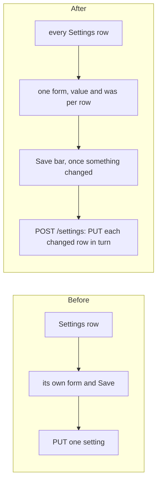

# Look 3, wave 2: the pages

> **In plain words.** The second wave of the new look, on the pages people use every day. Pages
> now arrive the way the owner approved for the other portal: the page rises out of a soft blur
> and its parts follow one after another, quickly. Home opens with a coloured welcome band that
> says what waits and leads straight to it, and Get started shows a bar of how far along it is.
> Settings has one Save bar that rises once something changed, instead of a Save button on every
> row, and on and off settings are real switches. An empty list is a calm box rather than a thin
> strip, and rows standing on a page sit on a card.

## What changed

- **Motion, on the timings the owner approved on 2026-11-08:** a page rises 6 px
  out of a 4 px blur over 320 ms; its parts rise 10 px over 360 ms, 60 ms apart, never more than
  240 ms late; Home's cards follow them. A page that comes back to itself (a filter, a save) or
  follows something live stays still, and the frame's script stops the arrival once the parts are
  in, so a live block that refreshes never replays it. The circle that brings new colours or a
  new theme now takes 560 ms. Nothing moves under reduced motion.
- **Home**: a welcome band in the portal's colours ("Welcome back", how many things wait, a chip to
  Needs you and to Get started); Get started gets a bar of the steps done (daisyUI's `progress`).
- **Settings**: every row belongs to one form; `POST /settings` saves only the rows that differ
  from what they showed, each through the API as if saved alone (checked and audited the same),
  and stops at the first refusal with its value kept. The `SaveBar` rises once anything changed,
  with Discard; without the page script it always shows. On and off settings are switches. The
  per-row routes stay for Reset to default and for anything that posts one setting.
- **Lists**: a table with no rows shows its sentence centred in a calm dashed box; `Rows` standing
  on the page rather than in a pane sit on a card. A search box's glass stays above daisyUI's
  field.

- **Email's words and pieces (wave 3, the kit's part).** The kit's Email entry Activity is now
  Delivery log, the word agreed with the client. `MailShell` takes `ownTabs` (the page's tabs row
  is left out when its folders hold the whole set) and a folder can be `apart`, after a line; the
  Email screens adopt them in oltrem-mail. `wide` (no list pane) lets Compose sit beside the
  folders too.

- **The rest of the pages, and an accessibility pass (wave 4).** Every page was drawn at phone
  width in light and dark and checked with axe (WCAG 2.1 A and AA rules) on this computer: Home,
  Settings, Users, My access, Alerts, the inbox, Sent, Write, Integrations, Look, Notifications,
  Records, Files, Tasks, Bookings, Customers, Analytics and the audit log. The one problem found,
  a provider's initials on a teal tile at 4.18:1, is fixed: letters on a group's tile lean to the
  text colour. A checklist's fix (Ready to send) is now a soft box to press instead of a long
  underlined sentence.

## Before and after

Each service: only the client's one Worker changes (its stylesheet, script and pages); the
settings API is the same and still checks and audits each value. No binding, variable, table or
key was added.

## Verified

- `@oltrem/screens` (`test/settings.test.ts`): one form and one Save bar, `value:` and `was:` per
  row, a switch with its hidden `off`, no Save on a row, the same-name form after the page's form.
- The template (`templates/client/test/screens.test.ts`): the page names the field and the bar;
  a post with nothing changed says so; a bad value is refused with its value kept; a good one is
  saved and shown.
- On this computer at phone width: the bar rises only after a change, Save shows the toast and the
  new value; Home, Settings, Alerts and Users drawn with no page errors.
- `@oltrem/core-ui` (`test/mail.test.tsx`): `ownTabs`, `apart` and `wide`.
- axe on this computer, phone width, light and dark, reduced motion: no violation on the 20 pages
  above after the fix.
- Not verified: a real phone (P76 to P79 and P90 in [the phone tests](../phone-tests.md)).
- `pnpm verify`: see the commit.
