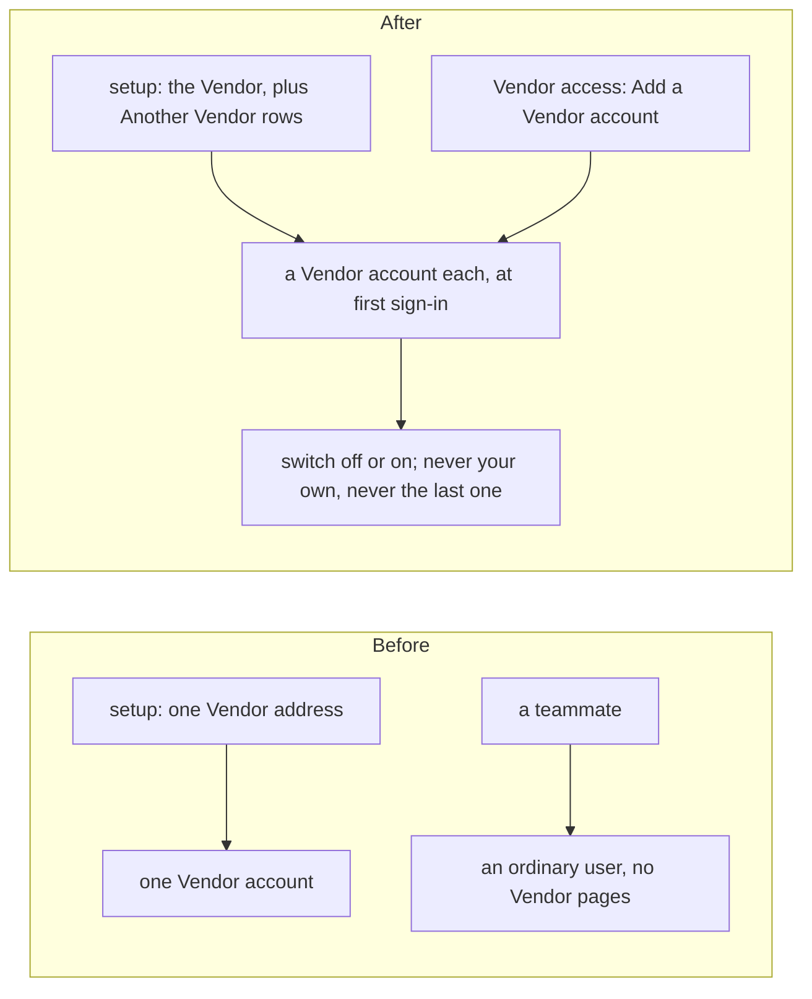

# Several Vendor accounts

> **In plain words.** A portal had exactly one Vendor account, so setup took one Vendor address and
> a teammate who also looks after the portal could only be an ordinary user. Now a portal can have
> as many Vendor accounts as you need. Setup's list of people takes "Another Vendor", and a Vendor
> adds, switches off and switches on Vendor accounts on the Vendor access page. Each one shows by
> its own address in the audit log. The owner chose this on 2026-11-08.

## What changed

- **Setup.** In "Who else will use the portal", an address can be **Another Vendor (everything,
  like you)**. It is written to `iam.setup_people` as `address vendor`, and the account is made at
  that address's first sign-in, before the company exists too. There is nothing to invite.
- **The portal.** Vendor access shows a Vendor (and only a Vendor) the **Vendor accounts**: each
  address, On or Off, with Switch off or Switch on, and **Add a Vendor account**. An address that
  already has an account is refused. A Vendor never switches off its own account, and the last one
  on stays on.
- **The rules.** A Vendor holds by its kind, as before, so every Vendor account holds what the
  Vendor holds, under the company's choice of how the Vendor may enter. No table, binding,
  variable or key was added: a Vendor account is a row of `iam_principals` of kind `vendor`.

## Before and after

Each service: the client's Worker makes and switches the accounts in its own database, with an
audit row for each (`iam.setup-admit`, `iam.vendor-add`, `iam.vendor-on`, `iam.vendor-off`); the
deploy writes the list as before; Cloudflare Access is unchanged (the door lets anyone ask for a
code, and the portal lets in only its own people).

## Verified

- `@oltrem/iam` (`modules/iam/test/setup-admit.test.ts`): a Vendor named at setup gets a Vendor
  account at first sign-in before the company, and nothing is made twice; a Vendor lists the
  accounts and a person of the company is refused; an address with an account is refused; an added
  address signs in at once; switched off, it is refused from its next request, and switched on it
  is back; its own account and the last one on are never switched off. The route count
  (`routes.test.ts`). All 79 iam tests pass.
- The template (`templates/client/test/screens.test.ts`): an Owner does not see Vendor accounts; the
  Vendor sees them, adds one, and switches it off.
- The deploy (`packages/cli/test/deploy.test.ts`, `door.test.ts`): "Another Vendor" in the list is
  written as `address vendor`; the role choices include it.
- Not verified: a second Vendor signing in on the live portal (P68).
- `pnpm verify`: see the commit.
