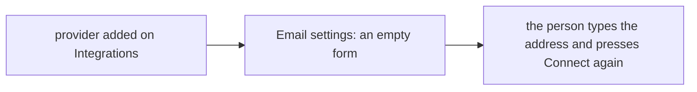
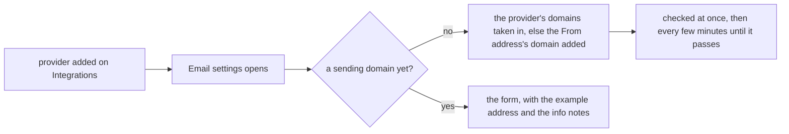

# Email settings made easy to start

> **In plain words.** The owner asked (2026-11-10) for Email settings to be easy to start: a
> full example of the sender address, explanations you can tap or hover in good colours, the
> domain checked by itself when an email provider is added, and smoother motion. Email settings
> now opens with three numbered steps. The sender address shows a full example on the company's
> own domain, which a tap fills in. Each field has a round info button with a tinted note. When
> a provider was added on Integrations and no domain is set up yet, opening Email settings adds
> the provider's domain, or the From address's domain, and checks it, with no press. The steps
> and each line of a result come in one after another.

## What changed, by part

| Part | Change |
|---|---|
| core-ui | `InfoTip`, and `info` on `FormField`: a round button beside the label opens a tinted note (the popover API; a tap, or a pointer resting on it where the browser has `interestfor`), fading in under the button |
| core-ui stylesheet | the info tip, the example chip (`ui-example`), and steps and result lines that arrive in turn (`ui-steps`, `ui-stagger`; not with reduced motion) |
| screens | the frame script fills a field from a button with `data-fill` and `data-value` |
| Oltrem Mail (taken in) | Email settings: the three steps, the example on the company's own domain (`GET /api/email/connect`), info notes on each field, the From address and name already set filled in, and a provider with no domain getting its domain added and checked when the page opens |

## Before and after

## Impact

- **Free plan:** the page asks the provider for its domains only while the portal has none, and
  only when someone opens Email settings.
- **Who:** a person who may not add domains sees the page as before; nothing is added.

## How it was verified

- core-ui: a test for the info button and note; screens: a test for `data-fill`.
- Oltrem Mail: tests for the example's domain, the start facts, and the domain added by itself
  (the provider's list first, else the From address's domain, nothing once there is a domain).
- On this computer: screenshots of Email settings on a computer and a phone, with the example
  filled in by a tap and a note open. Phone tests P100 to P102 in [phone-tests.md](../phone-tests.md).
