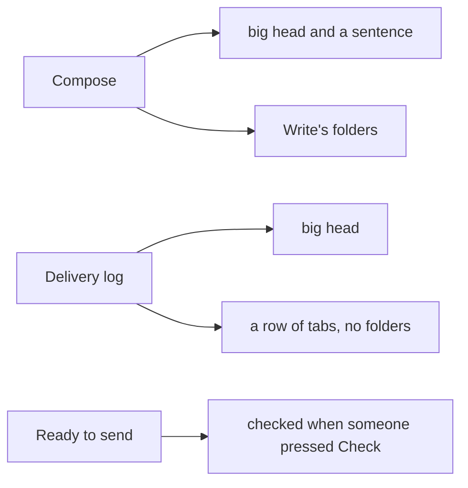
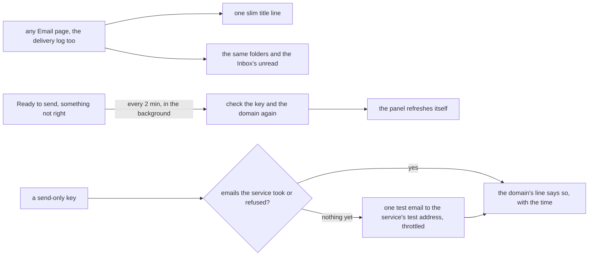

# Email's panes: one slim head, the same folders everywhere, Ready to send that checks itself

> **In plain words.** The owner looked at Compose on 2026-11-10 and asked for four things: the
> page's title and sentence took too much room; the folders on the left changed from page to
> page; Ready to send should check everything by itself; and the moves between pages felt
> rough. Now every Email page has one slim title line, the same folders in the same order with
> the Inbox's unread number, and the panes slide while the folder highlight glides. Ready to
> send checks again by itself every couple of minutes while something is not right, and the
> panel updates on its own. When the email service's key may only send, the portal learns
> whether the domain works from the emails the service takes or refuses, and with nothing to go
> on it sends one test email to the service's own test address (Resend's), at most a few times
> in the first day, then daily, and never once the domain is proven.

## What changed, by part

| Part | Change |
|---|---|
| core-ui `MailShell` | a `page` in place of the list and the reader, beside the folders that stay; the current folder carries a highlight (`ui-mail-pill`) that glides between folders |
| core-ui stylesheet | Email pages: one slim head (the summary is kept for screen readers), view-transition names on the folders, the list and the reader, the reader slides in, the list's rows arrive in turn (not with reduced motion); on a phone, Compose is the round button kept at the bottom right of the mail's own box, and the folder row opens at the current folder |
| screens | `createScreens({ frames })`: a kit page drawn inside a module's frame; the template hands `/email` to email's `emailFrame`, so the delivery log sits beside the folders |
| providers | a definition's optional `testInbox`; Resend's is its documented test address. The identifier scan allows that one address, which names no person or account |
| cli | the Node stand-in of a module's pages also has `emailFrame`, so the docs and the doctor still load the template's Worker |
| Oltrem Mail (taken in) | the folders on every page with add-on counts; Ready to send checks itself and refreshes live; a domain proven by real sends or the test email; migration `1013` keeps the last proof |

## Before and after

Before, each Email page drew its own head and its own set of folders, and Ready to send showed
what was known when the page opened.

After, every Email page shares one frame, and the checks run by themselves until they pass.

## Impact

- **Free plan:** the background checks run in `waitUntil` after the answer, at most every two
  minutes and only while something is not right; the live panel asks every 6 seconds while a
  check runs and every 30 otherwise, and stops when all is well.
- **The service's quota:** a test email counts as one email at Resend; it is sent at most every
  15 minutes in the first hour, hourly in the first day, then daily, and never once the domain
  is proven by a real email.
- **Database:** one column, `email_domains.send_proof` (migration `1013`, Oltrem Mail's range).

## How it was verified

- Oltrem Mail: `pnpm verify`, 11 gates passed, with tests for the folders and counts on every
  page, the frame, the self-check, and the proof from sends and the test inbox.
- The kit: the `MailShell` page and highlight tests, the screens `frames` test, the providers
  `testInbox` tests, and `pnpm verify`.
- On this computer, with Mail on: screenshots of Compose, Inbox, Sent, Templates, the delivery
  log and Mailboxes on a computer and a phone, which found the page jumping 34 pixels on open
  (the folder's scroll target moved the page on a computer; now a phone's row only) and the
  docs loader missing `emailFrame`. Phone tests P96 to P99 in [phone-tests.md](../phone-tests.md).
