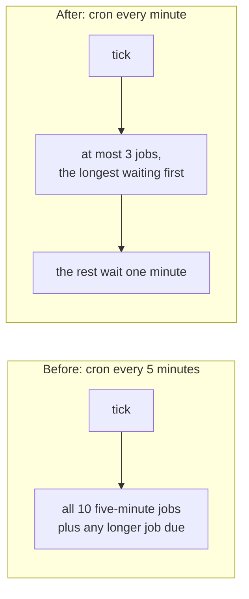

# Database reads, the timer's CPU, and the newest campaigns

> **In plain words.** The owner saw about 186,000 database rows read in under four hours on the
> live portal, with only him on it and two or three emails sent, and an average Worker CPU of
> 14 ms against the free plan's 10 ms. He asked for the smartest fix, and named browser storage,
> signed tokens and KV as ideas. The reads came from the campaign pages: each view, each Save
> and the report counted the whole list of people again. That is fixed in Oltrem Mail: the pages
> read a campaign's own counters instead, and this kit now carries that version. Browser storage,
> signed tokens and KV would not have helped, because the rows were read on the server to answer
> one person's page. For the CPU, the portal's timer ran ten jobs together every five minutes.
> Now it runs every minute and does at most three jobs a run, so each run is small. The Settings
> page also stops checking every stored setting again when the Worker already has them.

## Why the reads were high, and why the fix is on the server

D1 counts every row a query passes, also the rows a `COUNT(*)` walks. A campaign page counted
its people by status, joined the delivery log over the whole list, and the people tab and report
did the same: about four to eight rows per person on the list, on every view and every Save. A
list of a few thousand people makes tens of thousands of rows per minute of clicking.

| Idea | What it would do here |
|---|---|
| Keep data in the browser (`localStorage`, `sessionStorage`, an HTTP cache with a lifetime) | Saves a page view only when nothing changed, and a campaign page changes while it sends. The first view and every Save still read the rows. Personal data on a shared computer is a risk ([browser caching](../reference/browser-caching.md)). |
| A signed token (JWT) in a cookie | Replaces the session read, which is one KV read and under 0.1 ms ([CPU record](2026-11-01-cpu-budget.md)). It reads no fewer database rows. |
| A few KV keys | The free plan allows 1,000 KV writes a day, and counters change on every send. Settings and sessions are in KV and memory already. |
| Cloudflare's cache (Cache API) | It does nothing on a `workers.dev` address, where the live portal runs. |
| **Read less on the server** (chosen) | The campaign keeps its counters on its own row (`n_total`, `n_sent` and the others, already written by the sender), and the slower figures are kept for a minute while it sends and ten minutes once it is over (`tally`, migration `1012`). Measured on a list of 1,500 people: a campaign page under 60 rows, the list of campaigns under 60, the people tab under 250. |

Oltrem Mail's [record](../../vendor/mail/published/docs/records/2026-11-10-campaigns-reads-and-run-now.md)
holds the detail, with the campaign page's other changes from the same request: the steps, the
footer written in step 3, **Run now** and the live Run log.

## The timer's CPU

Measured on this computer with `wrangler dev` and the Chrome DevTools profiler, counting only
samples less than 1 ms apart (the way the [CPU record](2026-11-01-cpu-budget.md) counts), warm,
in ms:

| What runs | CPU |
|---|---|
| A tick with nothing due | 0.5 to 2.1 |
| One five-minute job alone (each of `alerts.release`, `analytics.rollup`, `automations.run`, `campaigns.send`, `developer.webhooks`, `email.domains`) | 1.4 to 3.3 |
| **Before**: all ten five-minute jobs, which landed on the same tick every five minutes | 6.4, 9.3, 17.7 |
| **After**: the same ten due, one tick, at most three run | 1.7, 2.8, 3.3, 3.9, 4.5 |

Before, every job due every five minutes became due on the same tick, so one invocation in five
did all the work. Now the cron is `* * * * *` and the scheduler takes at most `MAX_JOBS_PER_TICK`
(3) jobs a tick, oldest due first. The jobs spread over the minutes and stay spread, because each
one's next time counts from its own run. Ten five-minute jobs need two a minute, so each keeps its pace:
in the client template's test of 1,500 one-minute ticks (25 hours) every five-minute job ran 299
or 300 times, never more than six minutes apart, no tick ran more than three jobs or made more
than 45 queries, and each daily job ran once.

| Part | Change |
|---|---|
| `@oltrem/core-jobs` | `MAX_JOBS_PER_TICK = 3`, and `maxJobsPerTick` to change it. A job past the cap is `deferred`, without a lease, and goes first on the next tick. The flows' due window stays five minutes, which covers missed ticks; a minute already started is found by its instance name. |
| Client template | the cron is `* * * * *` in `wrangler.jsonc` and `oltrem.manifest.json`; `npm run dev` already ticked every minute. |
| `@oltrem/core-config` | the Settings page reuses the Worker's settings snapshot when its version is the stored one, instead of checking every stored value against its schema again (2.9 ms of that page's CPU in the profile). Another copy's save moves the version, and the page then reads the rows as before. |

What it costs: 1,440 invocations a day instead of 288, of the free plan's 100,000 requests. A
tick with nothing due reads the 25 rows of `oltrem_jobs`: about 36,000 rows a day, under 1% of
the 5 million. The total CPU of the jobs is the same; what changed is how much one invocation
does, which is what the 10 ms limit counts.

## What is still over 10 ms

- **A fresh copy of the Worker.** Its first request compiles each function as it is first called:
  about 35 to 48 ms for a page and 13 to 25 ms for a tick, measured on 2026-11-01. A tick every
  minute may keep a copy warm more often than one every five, but only Cloudflare's own figures
  can say how often a tick lands on a fresh copy.
- **V8's compile hint** (`//# allFunctionsCalledOnLoad`, which compiles every function when the
  script loads) was tried on a test Worker of 3,000 functions: its first request went from about
  86 ms to about 111 ms, its second from about 5.7 ms to 3.0 ms. Cloudflare's documents do not say
  whether start-up CPU counts against a request, so it was not adopted.

## How it was verified

- `@oltrem/core-jobs` tests: the new cap test, and the two tests of the write count and the query
  budget run with the cap lifted (they test those rules on their own).
- `@oltrem/core-config` tests: a new test lists from the snapshot, then saves from "another copy"
  (the version moved, this copy's memory not) and sees the new value, its source and who saved it.
- Oltrem Mail `3c32e20` taken in with `pnpm mail:pack`, `pnpm install`, `oltrem migrations sync`
  (migration `1012_campaigns_tally.sql` copied) and `oltrem docs`.
- The kit's whole verify chain; its summary is in the commit.
- Not checked: the figures on Cloudflare itself. The owner checks the client Worker's Metrics a
  day after the deploy: D1 rows read per day, and the CPU time per invocation.
