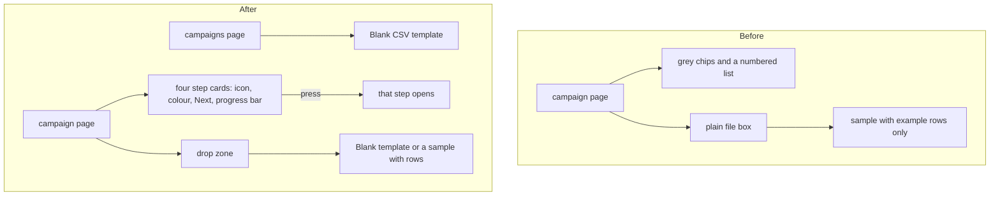

# A blank CSV template, and a livelier campaign page

> **In plain words.** On 2026-11-11 the owner sent a screenshot of a draft campaign and said it
> was bland, not good looking and not easy to work with, and asked for a blank CSV a person can
> download and fill in. Now the campaigns page offers a **Blank CSV template** before any campaign
> exists, and a campaign's list step offers **Blank template** (that message's own columns, no
> rows) beside the sample with example rows. A draft's four steps are four cards with an icon each,
> a colour for where each stands (done in green, the first open one marked **Next** in the
> portal's colour, one that needs something marked **Needs you**, the last one **Later**) and a bar
> of how many are done; pressing a card opens that step. The details under the title are chips with
> icons instead of one long line, and the list file goes in a large drop zone: drop a file on it or
> tap to choose one.

The change was checked against the owner's design skills (public copies of Emil Kowalski's design
engineering, Hallmark, Vercel's Web Interface Guidelines and UI/UX Pro Max): no middle-dot meta
line, 44 px touch targets, presses that shrink a little, the cards arriving with the kit's
existing motion (under 300 ms, still with reduced motion), and colour that says a state rather
than decorates.

## What changed

| Part | Before | After |
| --- | --- | --- |
| A blank list | none: only a sample with three example people | **Blank CSV template** on the campaigns page (`GET /template`: email, name, first_name, last_name, phone, company) and **Blank template** on a campaign (`GET /campaigns/:id/sample?blank=1`: email, name and the message's own fields) |
| The four steps | a row of grey chips and a plain numbered list | four cards with icons, a state colour, a **Next** marker, a progress bar, each a link to its step |
| The details under the title | one line of words joined by dots | chips: the stage, location, who started it, when, the address it goes from, the wording version, who approved it, each with an icon |
| The list file | a plain file box | a dashed drop zone in the portal's colour with an upload tile, both downloads under it |

## Before and after

Before, a person had to read the page to find what to do next. After, the next step is the
coloured card, and a list can be started from an empty file with the right headings.

## Impact on each part

- **Oltrem Mail, campaigns module**: `GET /template`, `blank=1` on `GET /campaigns/:id/sample`,
  the step cards, chips and drop zone on the campaign page; 38 routes.
- **The kit's screens**: the stylesheet rebuilt for the new classes; no script changed.
- **Workers, settings, variables, migrations, dependencies**: none new.

## How it was verified

- Tests: Oltrem Mail `modules/campaigns/test/campaigns.test.ts` (the blank sample's headings, the
  template's headings and file name, the route count) and `steps.test.ts`.
- Looked at on this computer with the template's portal (`dev --mail`), computer 1440 x 900 light
  and phone 390 x 844 dark: the index's template button, the four cards with step 1 marked Next,
  the chips, and the drop zone with both downloads.
- Phone tests P118 to P120 in [phone tests](../phone-tests.md).
