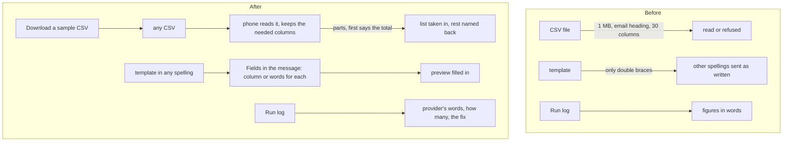

# Campaigns: any CSV, a sample list, template fields in any spelling, the provider's answers

> **In plain words.** On 2026-11-11 the owner asked for three things in Campaigns. First, a sample
> CSV to fill in, and a client's own CSV used as it is, keeping only what is needed, even a big
> one. Second, when a template is chosen, its fields pulled out whatever way they are written
> (`{phone_number}`, `{first_name}` and the like) so they are easy to change. Third, a live view of
> real runs: what the provider answered, what failed, why, and what fixes it, with Run now for a
> scheduled campaign. Now a campaign's list step has **Download a sample CSV** with the email
> column and the message's own fields; any file works, the email column found by its heading or
> its addresses, a wide file trimmed to the columns that matter and a big one sent from the phone
> in parts. The message step lists **Fields in the message**, each with the column that fills it
> and words for an empty value. The Run log shows the provider's words under each run with the fix.

The work is in Oltrem Mail (the email and campaigns modules), taken into the kit's `vendor/mail`,
and in the kit's frame script (`data-csv`). Run now for a scheduled campaign is in
[the record before](2026-11-11-campaigns-tidy.md).

## What changed

| Part | Before | After |
|---|---|---|
| The list file | 1 MB at most, an `email` column by a known heading, 30 columns at most or refused | any size from the page: read on the phone or computer, sent in parts of about 600,000 characters (the first says how many people the file has, so a file too long is refused before any part is taken); the email column found by heading or by its values; past 30 columns the address, the name, the files and the message's fields (by their other names too) kept first, the rest named back |
| A sample | none | **Download a sample CSV**: email, name and one column for each field the message names, three example people at example.com |
| Merge fields | `{{first_name}}` only | also `*\|FNAME\|*`, `{{ contact.FIRSTNAME }}`, `{{ first_name \| default: "there" }}`, `{first_name}`, `${first_name}`, `%first_name%`, all read as the same field, in campaigns, saved templates and Write |
| Fields in the message | the missing ones named in a sentence | a panel: each field, how it is written, the column that fills it (same name, a well-known other name such as `Celular` for `phone`, or picked from a row of the list's columns) and the words for an empty value; saved on the campaign (migration `1015_campaigns_fields.sql`) |
| Run log | each run in words | each run also keeps the provider's own answers for the people not sent to, grouped, with how many and the fix |

## Before and after

Before, a file from a client's own system was often refused and a template from another tool
went out with its tags unfilled. After, both are read as they are and the page says where each
value comes from.

## Impact on each part

- **Oltrem Mail, email module**: `merge`, `placeholders`, `fieldSpellings`, `designSpellings`;
  `readList` finds the address column by values and keeps the needed columns first (`need`,
  `dropped`). Saved lists read files the same way.
- **Oltrem Mail, campaigns module**: `POST /campaigns/:id/fields`, `GET /campaigns/:id/sample`,
  `total` on the list routes, `fields` and `keep` on a campaign's page, `answers` in the Run log.
- **The kit's screens**: the frame script's `data-csv` file box (about 5 KiB more script).
- **The client template**: migration `1015_campaigns_fields.sql`, additive.
- **Workers, settings, variables, dependencies**: none new. A part is read within the same 1 MB a
  request as before, so the free plan's CPU time is unchanged.

## How it was verified

- Tests: Oltrem Mail `modules/email/test/fields.test.ts` (each spelling, fallbacks, what is left as
  written) and `modules/campaigns/test/campaigns.test.ts` (the address by heading and values, 35
  columns trimmed, fields found, chosen and given words, the sample, the total refused first, the
  provider's answers and fixes); the kit `packages/screens/test/frame.test.ts` (a 3,000-row,
  35-column file sent in parts of 30 columns, then the page with `added`).
- Looked at on this computer with the template's portal (`dev --mail`), phone 390 x 844: a 1.3 MB
  file with 36 columns (`Correo`, `Nombre`, `Celular`, 31 extra) went in two parts in about a third
  of a second, 1,800 people; a message written with `*|FNAME|*`, `{plan}`, `{{ contact.PHONE }}`
  and `%REF_CODE%` listed four fields, `plan` from `plan` and `phone` from `celular`; the sample
  downloaded with those columns.
- Phone tests P114 to P117 in [phone tests](../phone-tests.md).
