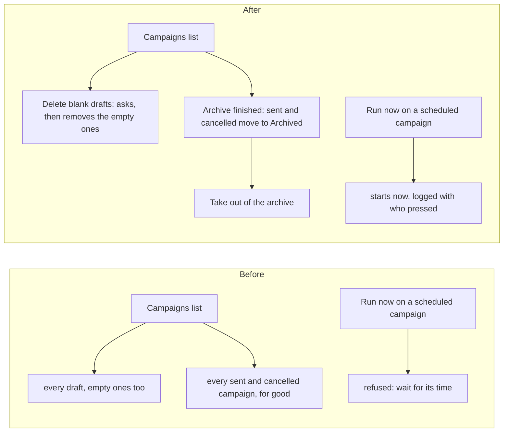

# Campaigns kept tidy, and Run now for a scheduled campaign

> **In plain words.** On 2026-11-11 the owner had made a few empty campaigns while trying the
> page, and asked for a way to delete them, to put away the campaigns that are done, and for
> someone allowed to press **Run now** on a campaign set to start later. Now the Campaigns page
> has **Delete blank drafts (N)**, which removes every draft with nothing in it after asking
> once; **Archive finished (N)**, which moves every sent or cancelled campaign off the list into
> an **Archived** chip, where each can be taken back; and Run now starts a scheduled campaign at
> once. Nothing archived is deleted.

The work is in Oltrem Mail (its campaigns module), taken into the kit's `vendor/mail` with this
commit.

## What changed

| Part | Before | After |
|---|---|---|
| Empty drafts | deleted one at a time from each draft's page | **Delete blank drafts (N)** on the list: no subject, message, template, saved list, people or files; each deletion audited |
| Finished campaigns | stayed on the list for good | **Archive** on a sent or cancelled campaign, or **Archive finished (N)** for all; the **Archived** chip lists them; **Take out of the archive** brings one back |
| Run now | refused a campaign waiting for its start time | starts it at once: the start time becomes the moment of the press, and the Run log says who pressed |
| Database | | migration `1014_campaigns_archive.sql`, additive: `campaigns.archived_at` |

## Before and after

Before, the list only grew. After, the empty drafts go in one press and the finished campaigns
move to their own chip, so the list shows what is still in work.

## Impact on each part

- **Oltrem Mail, campaigns module**: four routes (`POST /campaigns/remove-blank`,
  `POST /campaigns/archive-finished`, `POST /campaigns/:id/archive`, `/unarchive`, all
  `campaigns.write`), `archived=1` on the list route, the buttons and the chip.
- **The client template**: the migration copied in by `oltrem migrations sync`.
- **Workers, settings, variables, dependencies**: none new.

## How it was verified

- Oltrem Mail's tests: blank drafts deleted only where the person may write and only when empty;
  archive refused while sending, allowed once cancelled, listed under Archived and taken back;
  Run now on a scheduled campaign sends at once and logs who pressed.
- Looked at on this computer with the template's portal (`dev --mail`), phone 390 x 844 and
  computer 1440 x 900: two empty drafts made, **Delete blank drafts (2)** asked, deleted them and
  said so.
- Phone tests P112 and P113 in [phone tests](../phone-tests.md).
