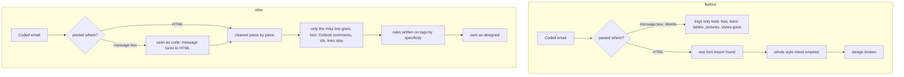

# A coded HTML email sent as designed, and noticed when pasted

> **In plain words.** On 2026-11-11 the owner said HTML emails were "one of the biggest problems":
> a coded email he sent was cleaned until the whole design broke, and the portal should notice
> code by itself. Two things caused it. When the email was sent as HTML, one line in its style
> sheet that loads a web font (an `@import` from Google Fonts, in almost every designed email) made
> the cleaner throw out the whole style sheet, so every colour, width, button and font went at
> once. When the code was pasted into the message box with Words chosen, the box kept only what
> its toolbar makes, so the tables, pictures and styles went. Now the cleaner takes out only the
> one line that could load or run something and keeps the rest; the web font stays. And code pasted
> into the message box turns the message to HTML with the code as it is, and says so.

Oltrem Mail 823f84c holds the email module's part, with two follow-ups the same morning: a7cc72d
(code pasted into the composer is read back and sent as code; a second clean no longer doubles the
inlined styles) and c4b6205 (that second clean keeps the author's fallbacks, `data:` pictures and
`&quot;` fonts). The kit keeps the c4b6205 pack (its `oltrem-mail.json`); the kit holds the message
box's part.

## What changed

| Part | Before | After |
| --- | --- | --- |
| A style sheet with a web font `@import` | the whole ``; after,
  the whole sheet with each rule on its tags, nothing taken out.
- Tests: Oltrem Mail `templates.test.ts` (the design kept, only the risky rules gone, an escaped
  `expression(` caught), `template.test.ts` (an id rule beats a later tag rule), `senders.test.ts`
  (a whole email sent with Words goes as HTML with its font import, Outlook comment, id and http
  link for Ann, and stays words for Zed, who may not use code); the kit's `frame.test.ts` (code
  pasted into the message box turns it to HTML for one who may use code and the send keeps it, and
  goes in as words from the plain text for one who may not).
- Looked at on this computer with the template's portal (`dev --mail`): a coded email pasted
  into the message box turned it to HTML with the note; Preview showed the hero, the button, the
  grey footer and the widths as coded (the preview's own policy loads no outside font). The first
  try showed an empty preview: the message box's copy was written over the code at Preview, which
  is fixed and tested.
- Phone test P131 in [the Email list](../phone-tests-email.md).
