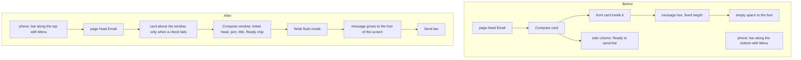

# Compose as one window, and the phone's bar back at the top

> **In plain words.** On 2026-11-11 the owner sent two screenshots. Compose looked bland and
> unfinished, with space wasted on every side: the "Ready to send · 5 checks pass" line held a
> whole column to itself beside the message, and the message box stopped well short of the foot
> of the screen. On the phone the owner wanted only the sidebar, not the bar along the bottom.
> Now Compose is one window: a head tinted in the portal's colour with a pen, the
> title, and Ready to send as a small chip that opens to its checks; the fields sit flush inside
> the window (no card inside a card); the message box grows down to the foot of the screen with
> Send under it; on a phone the window runs edge to edge. The phone has a bar along the top again:
> Menu opens the sidebar as a drawer, then the portal's name, Search and the bell. Nothing sits
> along the bottom, so pages run to the foot of the screen.

The change was checked against the owner's design skills (public copies of Emil Kowalski's
design engineering, Hallmark, Vercel's Web Interface Guidelines and UI/UX Pro Max): no card
inside a card, no middle-dot status line, 44 px touch targets in the bar, presses that shrink a
little, motion under 300 ms with a reduced-motion fallback, and colours mixed in oklab so a green
stays green.

## What changed

| Part | Before | After |
|---|---|---|
| Compose's layout | the form in a card inside the Compose card, a 20 rem column beside it holding only Ready to send (the preview there hid itself once the composer started) | one column: the fields flush in the window, the message growing to the foot of the screen (`ui-compose-grow`), the window as tall as the screen less the head (`--ui-compose-top`) |
| Compose's head | a grey strip with the title | tinted in the brand's colour, the pen in a filled tile, the title, then `aside` |
| Ready to send | a line in the side column, a pane when a check needed a look, a card above the form when one failed | a chip in the head (`ui-status`, green, amber or red) that opens to every check and Check again; a failing check still raises its card, now above the window instead of inside it |
| Compose on a phone | inside the page's gutters, with the bottom bar under it | edge to edge; the message box 10 rem high at least, so Send shows without much scrolling |
| The phone's bar | along the bottom: Home, Email, Search, Alerts, Menu (daisyUI `dock`) | along the top: Menu, the portal's mark and name, Search, the bell with its badge (`PhoneBar`, `ui-phone-bar`); daisyUI's `dock` and `indicator` are no longer built |
| Things floating at the foot of a phone | toasts, the save bar and Email's round Compose 76 to 80 px up, clear of the bottom bar | 12 to 20 px up, at the foot |

## Before and after

Before, the page drew a card in a card and a side column for one line, and the message box kept
its own fixed height, so a tall screen showed empty space under it. After, the window's height
follows the screen and the space goes to the message; Ready to send takes the width of a chip.

## Impact on each part

- **`@oltrem/core-ui`**: `ComposeSheet` gains `aside` and draws the pen; new classes
  `ui-compose-grow`, `ui-compose-hint`, `ui-compose-foot`, `ui-status`, `ui-phone-bar`,
  `ui-phone-btn`, `ui-phone-brand`, `ui-phone-count`; `.ui-dock` and daisyUI's `dock` and
  `indicator` removed. The stylesheet stays under its 128 KiB cap.
- **`@oltrem/screens`**: the frame draws `PhoneBar` at the top of the page column instead of the
  bottom bar; the drawer is the same.
- **Oltrem Mail** (its own commit, taken in after this one): Compose uses the chip, the flush form
  and the card above the window.
- **Workers, data, settings**: none. No new route, table, binding, variable or dependency.

## How it was verified

- Looked at on this computer with the template's portal (`dev --mail`), computer 1440 x 900 and
  phone 390 x 844, light and dark, the chip open and closed, the drawer open: the window runs from
  56 px to 860 px on the computer (the screen is 900) and from 158 px to 818 px on the phone.
- Tests: `packages/core-ui/test/mail.test.tsx` (the head's pen, title and aside in order),
  `packages/screens/test/css.test.ts` (the tall window, the growing message, the phone's edge to
  edge, the chip's tones, no dock and no 76 or 80 px offsets), `packages/screens/test/module-pages.test.ts`
  (the bar along the top with Menu opening the drawer, no Quick links bar).
- Phone tests P71 and P72 rewritten, P75, P76 and P97 updated, P109 to P111 added in
  [phone tests](../phone-tests.md).
