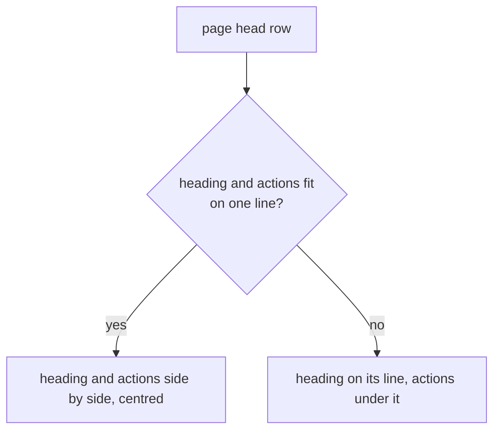

# The Email pages tidied for a phone: the kit's part

> **In plain words.** The owner sent phone screenshots of Write and Email settings > Addresses
> and asked for every Email page to be reviewed for spacing, wasted room and arrangement. Every
> page was photographed at a phone's width and checked against published interface rules
> (Vercel's Web Interface Guidelines, 44 px touch targets, no box inside a box, one chip look,
> no visible scrollbars on a sideways row). Most fixes are in Oltrem Mail's pages (its own record
> of the same day, packed in [vendor/mail](../../vendor/mail/README.md)); the ones below are the
> kit's, so every page that uses these parts gets them.

## What changed

| Part | Before | Now |
|---|---|---|
| A page's head | the heading kept 16 rem, so a short title pushed its buttons onto a second line, a few pixels off the heading's centre | the heading needs 8 rem; a short title keeps its buttons beside it, centred; a long one wraps under |
| A pane's head | the title and its tools on one line, so a long domain name broke mid-word | the head wraps: the title keeps whole words and the tools go under it |
| An empty state inside a box | a dashed border inside the box's own border | no border of its own inside a dashed box, a pane or the mail list |
| A chip | a grey filled tag that read as switched off beside the mail folders' bordered pills | one look everywhere: a bordered pill on the surface, tinted when chosen |
| The phone's folder row | cut hard at the screen edge, a chip half shown | fades out at both edges, as the tab rows do |
| The row of tabs | the marked tab scrolled flush to the left, so nothing showed there was more before it | the marked tab with the one before it whole |
| Write's label column | 68 px | 52 px, more room for the address |
| The toolbar and Send bar | a scrollbar showed under them on some phones | no visible scrollbar; they still scroll sideways |
| The round Compose button | covered the last line of a long list | the page keeps 96 px free at its foot when the button is there |
| The 14-day chart with nothing sent | an empty chart and an empty table | one line: "No email in the last 14 days." |

## How a page head lays out now

Before, the heading asked for 16 rem whatever its length; on a 390 px phone that left less room
than two buttons need, so even "Email" pushed them down. Now it asks for 8 rem.

## How it was checked

- Every Email page photographed at 390 px wide, light mode, before and after, on the local
  portal with real local data.
- `test/css.test.ts` holds the new rules (empty state, pane head, head text, toolbar scrollbar,
  Compose button room, chip pill); `test/frame.test.ts` the row of tabs opening with the tab
  before the marked one whole; `test/mail-trend.test.ts` the empty chart's single line.
- The stylesheet stays under its 144 KiB cap: the font weights are written as numbers rather
  than variables, which freed about 1 KB.
- `pnpm verify` green before the push.

## Later the same day: a dropdown for Write's From

The owner asked for Write's From to be a dropdown like the first client's. The kit gains
`details.ui-drop` with `data-pick`: radios under the line in a card (`ui-menu-pop`, under the line
on a phone too rather than a sheet), each option 48 px, tinted with a tick when chosen. The
frame script shows the chosen option's face in the line, closes the card on a press (the
option already chosen too), on Enter (which would otherwise send the form) and on Escape or a
click elsewhere; the arrow keys only move the choice. `test/frame.test.ts` holds those moves.
To pay for the rules within the 144 KiB cap, the two text sizes are written as pixels rather
than variables, as the weights were.
