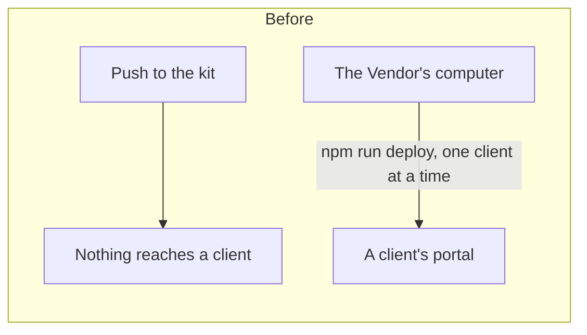
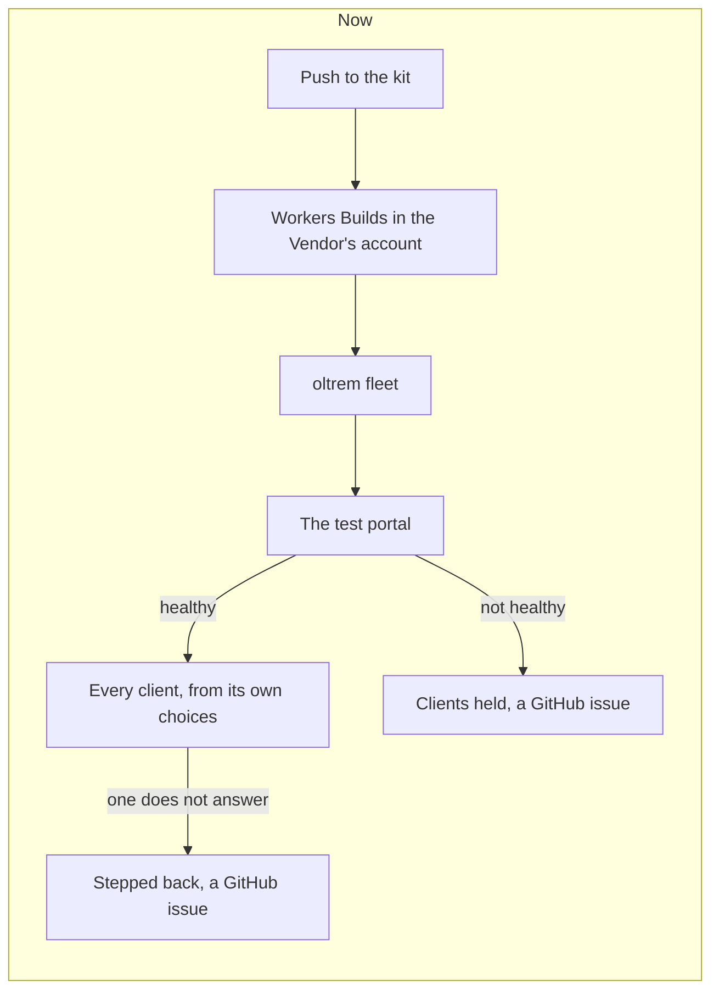

# Every push to the kit updates every client's portal

> **In plain words.** On 2026-11-11 the owner asked for one Cloudflare key in the kit's repository
> so that every build he pushes reaches every client by itself: the migrations, the code and the
> build, each client adapted to its own choices, the default where it made none, checked, and a
> message somewhere when something breaks. He could not connect many clients' Cloudflare accounts
> to the same repository. He chose "every push, test portal first". Now one build in his own
> Cloudflare account finds every portal its key reaches, updates his test portal first, then each
> client from its own recorded choices, with a restore point, the migrations, a health check and
> a step back, skips a portal already current, and opens a GitHub issue for a portal that did not
> update. The key lives only in Cloudflare's build secrets.

## What changed, and why

| Part | Before | After |
|---|---|---|
| How a client gets a new kit | the plan: a GitHub Actions deploy in each client repository, a key per client, an upgrade proposal per kit release (the fleet step, never built); in practice `npm run deploy` by hand | `oltrem fleet` in one Workers Builds connection in the Vendor's account, on every push to `main` |
| Where a client's choices live | in the files of the computer that deployed it | also in the portal's own database (`oltrem_meta` `build_choices`), written by every deploy and every fleet update |
| The key | `CLOUDFLARE_API_TOKEN` per client repository, never made | `OLTREM_FLEET_TOKEN`, one user token of the Vendor, a build secret in the Vendor's account |
| When something breaks | the deploy's own step back; nothing told anyone | the same step back, the build red, a GitHub issue per portal that closes itself |
| Spend | GitHub Actions minutes per client | the Vendor's account's free build minutes; no GitHub Actions minutes |

Workers Builds was declined in research 18 for four reasons; each is answered here. A GitHub
account points at one Cloudflare account: only the Vendor's is connected. Its build key has no
D1 right: the fleet brings its own key. Connecting it needs a person: once, in the dashboard.
Agents cannot read its logs: the GitHub issue carries the log of a portal that failed.

## How it worked before and how it works now

Before, a push to the kit changed no portal. Each portal was updated by running `npm run deploy`
on the Vendor's computer, from the files there.

Now a push to `main` that touches the kit's code starts one build. It updates the test portals,
then each client one at a time, from that client's choices. A client whose code and choices did
not change is skipped.

## Impact on each part

- **`@oltrem/cli`:** new `fleet` command (`src/fleet.ts`) and `src/choices.ts`; `oltrem deploy`
  records the choices after its health check. `oltrem release` is reused unchanged.
- **The client template:** unchanged. The fleet builds a copy of it in `.fleet/` (ignored by git).
- **Client portals:** one row more in `oltrem_meta` (no migration: the table exists since 0001).
- **The token registry:** `OLTREM_FLEET_TOKEN` and `OLTREM_FLEET_GITHUB_TOKEN`, planned.
- **The owner:** the one-time setup in [the fleet](../reference/fleet.md).

## How it was verified

- `packages/cli/test/fleet.test.ts`, twenty-four tests: choices read, defaulted and recorded with
  quotes doubled; the template copy beside `templates/` with a name, an address and Oltrem Mail
  written in, read back the same; wrangler's environment without Workers Builds' variables;
  portals found through a stand-in of Cloudflare's API (recorded, read from the Worker, other
  databases ignored, a refused account said); the test portal first, a failed or missing one
  holding the rest, current and switched-off portals skipped, `--check`; the fingerprint; the
  GitHub issues opened, added to and closed, and a refused GitHub said without throwing; a
  real release path with wrangler stood in for (each copy deployed on its own account under its
  own name, only a good one recorded, the copy removed); the command line's missing key,
  `--check` and a failing run that opens issues.
- A copy built by `templateCopy` with Mail chosen was bundled by `wrangler deploy --dry-run`:
  every binding named for that client, Oltrem Mail's `EMAIL` among them.
- The full verify chain (summary in the commit).
- Not verified here: a run inside Workers Builds against real accounts. That is the owner's
  one-time setup, then the first push.
