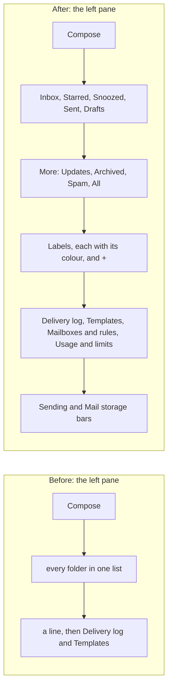

# Email made to work like Gmail

> **In plain words.** The owner asked that anyone coming from Gmail find what they know in Email,
> that the left pane look better, and that each page say how much of every free allowance is
> used, in words a client understands. Oltrem Mail built the features (its record,
> `synced-docs/oltrem-mail/docs/records/2026-11-11-gmail-style-email.md`): stars, labels with
> colours, Gmail's keyboard shortcuts, the top bar with its menus, Quick settings, and the Usage
> and limits page. The kit's part is the look they are drawn with: the left pane in Gmail's
> groups, with More folded, Labels with a coloured dot each, and two small bars at its foot
> (emails sent and mail storage) that turn amber and then red as they fill.

## What changed

| Part | Before | After |
|---|---|---|
| `MailShell`'s folders | one list, a line before the folders marked `apart` | grouped: the main folders, **More** folded (open by itself when it holds the current folder), **Labels** with a dot in each label's colour and a + to make one, then the tools after a line |
| The pane's foot | nothing | `meters`: each a label, its value in words and a thin bar (`MeterLine`), a link to the page that explains it; green, amber from 70%, red from 90%, grey when not known (`meterTone`), always with words, never colour alone |
| A row (`ConversationRow`) | who, when, subject, first words, star | as before, plus its labels as coloured chips and a paperclip for a file |
| The list's top bar | the page drew its own | `MailBar`: the box that ticks every row, the commands for the ticked rows, the range at its end; menus (`details.ui-menu`) for Snooze, Label and More, a sheet from the bottom on a phone |
| Label colours | none | `LABEL_COLORS` (nine, `gray` first) and `labelColor`, each a fixed mid-tone that reads on light and dark alike |
| vendor/mail | Oltrem Mail c4b6205 | Oltrem Mail 3a00a81, and its migration 1016 (stars, labels, each mailbox's running total of stored bytes) in the template |

## Before and after

The groups are data on each folder (`group`), so an add-on's folder lands in the right place
without the kit knowing it. The bars take a share and words from the page; the kit only draws
them, so no figure is computed or guessed here.

## The stylesheet's limit

The pane, the menus and the bars need about 16 KB of styles: the screens' stylesheet went from
about 130.7 KB to 146.5 KB (about 3.6 KB more over the wire, compressed). The owner said yes on
2026-11-11 to raising its test from 128 KiB to 144 KiB (`packages/screens/test/css.test.ts`). It
stands about 1 KB under the new limit, so the next change to the look reuses classes already in it.
The mail pages use core-ui's own `Button` and `CONTROL`, not daisyUI's `btn` and `input`, which
would have added about 7 KB.

## How it was checked

- core-ui's mail tests (20): the groups and their order, More opening by itself, labels with
  their dots and the +, the meters and their tones, `labelColor`, `MeterLine` with and without a
  link, the row's chips and paperclip, and `MailBar`.
- The template's portal on this computer with Oltrem Mail linked in: the pane, the label chips,
  the bars, the menus on a computer and as a sheet at phone width.
- `pnpm verify` before the push.
- Phone tests P138 and P139 in [Phone tests owed: Email and Mail](../phone-tests-email.md).
