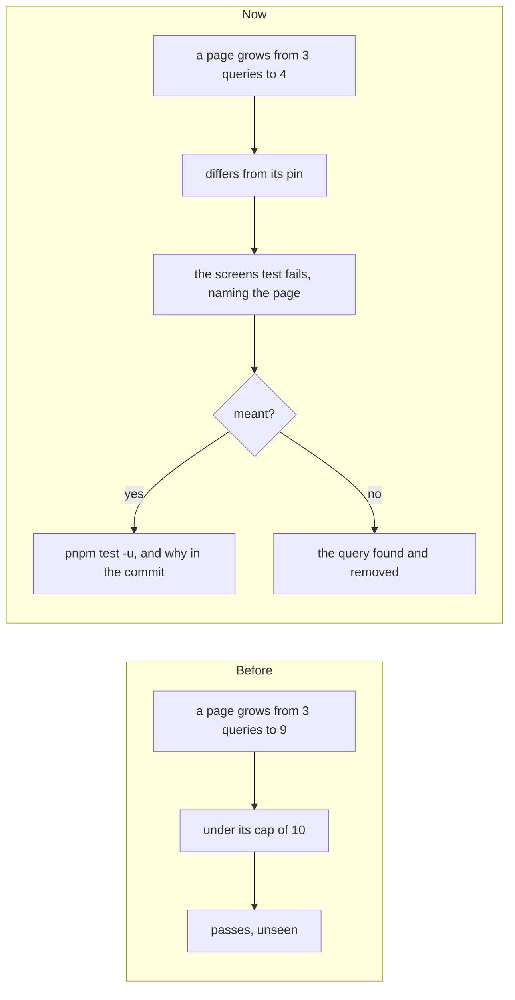

# Each page's queries pinned, and each page's CPU measured

> **In plain words.** The owner asked how the first client's admin portal stays fast with so
> many pages and rules, which of its habits the kit should take, and then to build the best of
> them for the long run. Most of them the kit already had: the permission map worked out once at
> sign-in and kept with the session, one session read a page, a capability on every route, the
> size and coverage limits, the walls between modules, and a live CPU figure on System health.
> Two were missing. That portal pins each count it cares about in a file, so a slow rise is
> caught the day it happens, not once it reaches the limit. And it keeps a table of what each
> page costs. Now each page's number of database queries is pinned in the kit's tests: one query
> more than before fails the check, even far under the limit, until the change is meant and
> pinned again. And `pnpm cpu` measures the processor time of every page and of the cron tick on
> this computer, and ranks them.

## What changed

| Area | Before | Now |
|---|---|---|
| Queries a page makes | each page held under a cap (Home 40, the others 10, of the 50 an invocation may make on the free plan); a page could go from 3 to 10 unseen | the caps stay, and each page's count is pinned in `test/__snapshots__/screens.test.ts.snap`; any change fails the screens test with the page, its pin and its new count |
| Pinning again | none | a change that means it runs `pnpm test -u` in the template and says why in its commit, as with the size budget; a fall is pinned the same way, so the pin never sits above the truth |
| A client's own pages | the same caps | the same caps; a new client starts without the kit's pins (`oltrem new client` leaves `__snapshots__` behind, its pages and modules being its own) and pins its own with `PIN=1 pnpm test -u` once |
| CPU of each page | measured by hand, page by page, in earlier work | `pnpm cpu` in the kit: starts the template's portal on this computer, signs in as the Vendor, warms each page, profiles it 7 times through the runtime's inspector, and does the same for the cron tick; it prints each one's fastest, median and slowest round |

The pins on 11 November 2026, with the journeys of the screens test behind them: Home 32 of its
40; Providers 8; People, Files and Tasks 6; Audit and Campaigns 5; every other page 1 to 4.

## How a rise is caught

The counting is the one the tick already uses to keep under the free plan's 50 queries
(`countQueries` in `@oltrem/core-jobs`): a batch counts as one, as Cloudflare counts it. Run three
times, the counts were the same each time; a pin changed by hand from 6 to 5 failed with
`"/people": 6` against `5`.

## What `pnpm cpu` showed

On this computer, the fastest of 7 rounds: Home about 35 ms and Analytics about 26 ms, Providers
about 21 ms, most pages 5 to 17 ms, and the cron tick about 3 ms. These are not production
numbers: the local database stand-in costs several times what Cloudflare's does, and anything
the runtime does meanwhile (the local tick's jobs, a queued email's delivery) lands in the same
profile, which is why rounds of 75 ms or more appear and the fastest round is the one ranked.
They rank pages and compare one day's code with the next. The live figure stays the CPU budget
on System health.

## Looked at, and not built

- **Loading modules on first use.** It would make a fresh copy of the Worker start faster, but
  the start has room (about 125 ms of its 1 s limit), and the work moved would land inside the
  first request, which has 10 ms. The kit's size rule already says to keep code small rather than
  load it later (`scripts/lib/size.mjs`), and what is worth preparing early is already prepared
  while the Worker loads (the router, the time-zone formatters, [2026-11-01](2026-11-01-cpu-budget.md)).
- **Database read copies near the visitor.** Cloudflare's D1 read replication costs nothing
  extra, but it is still marked beta, its use on the free plan is not stated, and every query
  would need the Sessions API. Left until it is generally available.
- **A signed session cookie.** Measured before and not built: reading the session costs under
  0.1 ms on a warm page ([2026-11-01](2026-11-01-cpu-budget.md)).

## What to watch next

- **Home at 32 of its 40 queries.** It asks every module for its card and what waits, so each
  new module adds to it. When it nears 40, the modules' cards should be read in one batch.
- **The cron tick.** On the first client's portal most cron runs went over 10 ms; here the tick
  measured about 3 ms, and `pnpm cpu` keeps measuring it with the pages.
- **Analytics and Home are the costliest pages** in `pnpm cpu`; they are the first to look at if
  the live CPU figure on System health turns amber.

## How it was checked

- The screens test written, then run three times in CI mode: 46 tests passed each time, the pins
  unchanged. One pin lowered by hand failed it with the page's name and both counts.
- `oltrem new client`'s copy test: a template's `test/__snapshots__/` is not copied.
- `scripts/cpu.test.mjs`: a profile's CPU without the waiting, the median, the pages measured and
  the table's order (4 tests); `pnpm cpu` run end to end on the template, every page answering 200.
- `pnpm verify` before the push.
