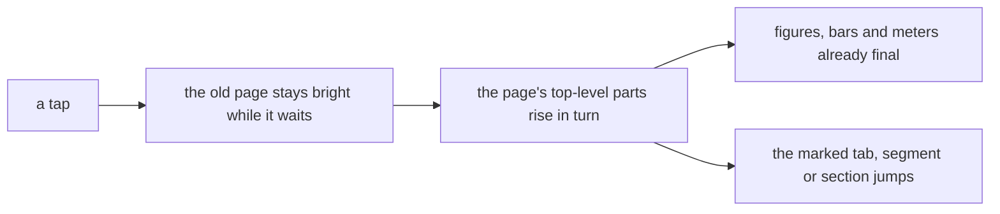
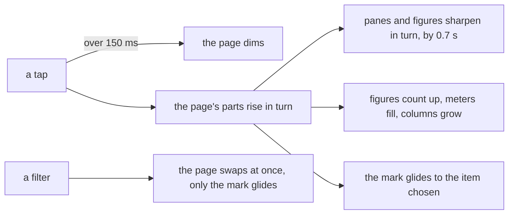

# Pages that move like the owner's clips

> **In plain words.** On 2026-11-11 the owner sent two dashboard clips (V22 and the glassy V30)
> and asked whether the portal could move the same way. Most of it can, with CSS and a little of
> the frame's own script, no library. When a page arrives, its panes and each figure's words now
> come in one after another and sharpen from a light blur. The figures count up from zero, the
> meters fill, and a chart's columns grow from their base. The marked section in the sidebar,
> the marked tab and the marked filter glide to the one chosen instead of jumping. A page that
> takes more than 150 ms to answer dims at once, so a press is seen. Nothing of it plays again
> on a filter, a save or a live refresh, and nothing moves with reduce motion on. The glass look
> belongs to the portal look redesign, not to this change.

## What changed, by part

| Part | Change |
|---|---|
| core-ui stylesheet | `ui-sharpen` (a rise of 8 px from a 4 px blur, 400 ms) on the panes of a `PaneGrid` and the words of each figure, 60 ms apart up to 300 ms; `ui-grow` on a `ColumnChart`'s columns, 25 ms apart up to 300 ms where the browser has `sibling-index()`; the mark (`ui-mark`) that draws the marked tab's underline, the marked segment's tint and the marked section's tint and edge; `data-vt="mark"`, under which only the mark moves; a page `data-loading` at 60% |
| screens frame script | adds the mark to the marked tab, segment and section; names the old mark and the new one alike for a page change when both pages have the same row in the same place; a filter on the same page runs a transition of the mark alone; counts a page's plain figures up from zero (700 ms, a hidden copy, the real figure kept for a screen reader) and fills its meters (600 ms); dims the page after 150 ms of waiting |

Email's pages take part too: these move inside a pane, never the pane itself, so nothing
arrives twice. A page with a live block (`data-refresh`) stays still, as it did before.

## Before and after

Before, a page arrived as a few large blocks, its numbers and bars already final, and the
marked item jumped to its new place.

After, the parts inside a block come in one by one, the numbers and bars move to their values,
and the mark glides.

## Impact

- **Free plan:** none on the Worker; all of it runs in the browser.
- **Size:** about 3 KiB of stylesheet once built and 6 KiB of script with its comments, before
  compression.
- **Phones:** transform and opacity only, plus a short 4 px blur on the few items arriving.
- **Without the script, or without view transitions:** the marked item keeps its own look, the
  figures show their values, and the page simply changes.

## How it was verified

- The screens tests: a slow page dims after 150 ms and not before; a page that arrives counts
  `1,234` up through `1,080` to `1,234`, its real figure kept for a screen reader, and leaves
  `999+` and a live block alone; a filter gives the old and new marked segment one name and runs
  a transition of the mark alone; the stylesheet carries each rule.
- On this computer, with Mail on, animations slowed tenfold: the sidebar's mark glides from
  Records over Forms and Tasks to Approvals; the delivery log's figures arrive blurred and
  sharpen in turn; the filter's mark glides from Everything to Failed while the page swaps at
  once. No console errors on a computer or a phone.
- The plan, the clips' timings and the research: the motion plan document linked from the thread.
  Phone tests P103 to P106 in [phone-tests.md](../phone-tests.md).
