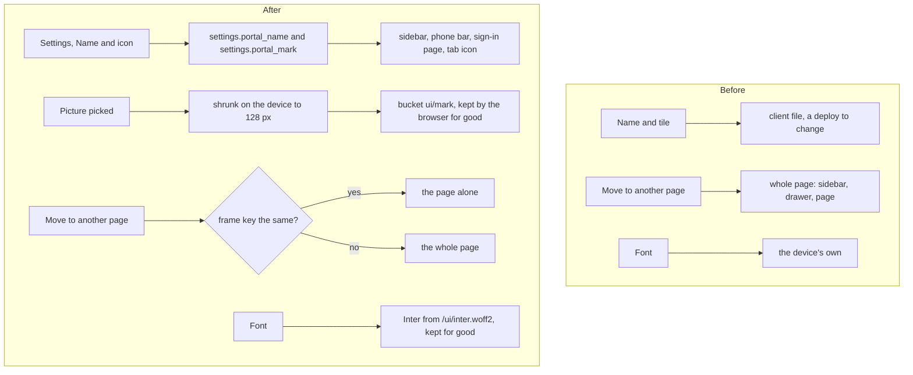

# The portal's own name and icon, the Inter font, and lighter page moves

> **In plain words.** On 2026-11-11 the owner asked for four things: stay well inside the free
> plan's 10 ms of CPU per request, a better font, design and motion, one icon library for
> everything, and a setting on Settings where the Owner and the Vendor change the sidebar's name
> and icon, kept light and quick to load. Now Settings opens with **Name and icon**: a name of up
> to 40 letters and a tile of the portal's initials, one of 32 icons, or a picture. A picture is
> shrunk on the person's own phone or computer to a 128 px square, a few kilobytes, before it is
> sent. The name and icon show in the sidebar, on a phone's top bar, on the sign-in page and as
> the browser tab's icon. Every page after the first now leaves the sidebar where it is and brings
> only the page itself, 40 to 80 percent less to send and 1 to 2.5 ms less CPU. The portal has its
> own font, Inter, and a figure that changes while it is on screen glides to its new value.

The owner also said that English is always first and other languages come only on request
(2026-11-11): Inter's Latin letters carry English and every accent Spanish needs.

## What changed

| Part | Before | After |
| --- | --- | --- |
| The sidebar's name | the client file's name, changed only by a deploy | `settings.portal_name` on Settings, up to 40 letters; empty is the client file's name |
| The sidebar's tile | the portal's initials | `settings.portal_mark`: the initials, one of 32 icons, or a picture kept in the portal's bucket |
| The browser tab's icon | none, so the browser asked for `/favicon.ico` | the tile drawn as a small picture written into the page, on the look's colours, or the picture itself |
| The font | the device's own (system-ui) | Inter Variable, served by the portal at `/ui/inter.woff2`, kept by the browser for good; the device's own until it arrives |
| A move to another page | the whole page sent again, sidebar and drawer included | only the page itself when the sidebar the browser holds is still right (`x-ui-frame`) |
| A live figure | swapped at once | glides to its new value in 400 ms (none under reduced motion) |
| Phone tests | one file | the Email and Mail tests in [their own file](../phone-tests-email.md), as the first passed its size |

## The CPU, measured

Measured on this computer with the template's portal (`dev --mail`), its inspector and the CPU
profiler, as in [the record of 2026-11-10](2026-11-10-reads-cpu-and-campaigns.md): active CPU per
request, the median of several warm runs, in milliseconds.

| Page | Before | After, whole page | After, a move from another page | What a move sends |
| --- | --- | --- | --- | --- |
| Home | 10.1 | 11.2 | 9.0 | 29 KB instead of 71 KB |
| Settings | 6.3 | 7.5 | 4.7 | 107 KB instead of 149 KB |
| Email, Write | 7.3 | 6.8 | 5.6 | 57 KB instead of 98 KB |
| People | 4.0 | 4.5 | 3.4 | 11 KB instead of 52 KB |
| Campaigns | 5.0 | 4.8 | 3.5 | 36 KB instead of 78 KB |

Runs of the same code move by 1 to 3 ms, so the whole pages are where they were; Settings is a
little heavier for the 34 tiles of the new card. Every page after the first is now a move. Home
stays close to the line: about 25 database reads and their wrappers make up 3 ms of it and the
drawing 3 ms. The first request of a fresh copy of the Worker is still 17 to 32 ms here, as V8
compiles each function the first time it runs. Production processors differ from this computer,
so the owner's check stays Cloudflare's own CPU time per request.

## Why it is built this way

- **The browser's cache, not localStorage.** The owner suggested keeping the icon in session or
  local storage. A picture is served at an address named after its contents
  (`/ui/mark/<16 hex>.webp`), marked to be kept for good: the browser asks for it once, shows it on
  the first paint of every page with no script, and a new picture is a new address. Storage needs
  a script to put it back after the page is drawn, so the tile would flash empty first. The name
  is a few letters in the page and needs neither.
- **The picture is made small where it is picked.** The page draws it on a 128 px canvas and sends
  WebP (PNG where the browser cannot), about 1 to 8 KB. The Worker takes only a WebP, PNG or JPEG
  read from its own first bytes, at most 48 KB, and never an SVG, which can carry a script.
- **One icon library, the one already here.** Lucide (`lucide-preact`) draws every icon of the
  portal; only the icons a page uses are in the Worker, and the 32 icons of the picker come from
  it. A second library or an icon font would weigh on every page for icons nobody picks.
- **One font file, Latin letters only.** 47 KiB, the one new package (`@fontsource-variable/inter`,
  used by the stylesheet's build only, SIL Open Font License 1.1, its notice kept in the generated
  file). The Worker serves it like the stylesheet, so it needs no static assets
  ([why](2026-11-04-sign-in-and-static-files.md)) and no outside font service.
- **The known frame.** The script sends a short key of the frame it holds (the portal's name and
  icon, the person, the sidebar's rows, the unread count). When the server's key is the same it
  answers the page alone; when it differs, the browser opens the page whole.

## Before and after

## Impact on each part

- **Settings (`@oltrem/core-config`)**: two system settings, `settings.portal_name` and
  `settings.portal_mark`, that only an Owner and the Vendor change, with effect at once.
- **The kit's screens**: the Name and icon card, the two public routes (`/ui/inter.woff2` and
  `/ui/mark/:file`, before the sign-in, as the sign-in page shows the icon too), the tab icon, the
  known frame, the gliding figures. The stylesheet stays under its 128 KiB cap.
- **The client template**: hands the settings snapshot's name and icon (`brand`) and its bucket
  (`files`) to the screens.
- **Workers, bindings, variables, migrations**: none new. The picture is a file in the portal's one
  bucket and the two values are rows of its settings table.
- **Oltrem Mail**: not changed.

## How it was verified

- Tests: `packages/screens/test/marks.test.ts` (what each value names, a picture refused by its
  bytes or size, the tab icon); `packages/screens/test/frame.test.ts` (the frame key sent, a page
  with another key opened whole, a live figure gliding); the client template's screens test (the
  Vendor saves a name and an icon, then a real WebP picture that is served back kept for good; a
  move with the right key gets the page alone; the font served under its version).
- Looked at on this computer, computer and phone sizes: the name and icon in the sidebar, the
  drawer, the phone bar and the tab; a picture of 1,384 bytes stored and served as `image/webp`; a
  move keeping the sidebar and marking the new section; no console errors.
- Phone tests P127 to P130 in [phone tests](../phone-tests.md).

## What is left

- The drawer's copy of the sidebar is still in a whole page, about 1 ms and 19 KB on the first page
  only.
- Home sits near 9 to 11 ms on this computer; fewer of its database reads would be the next cut.
