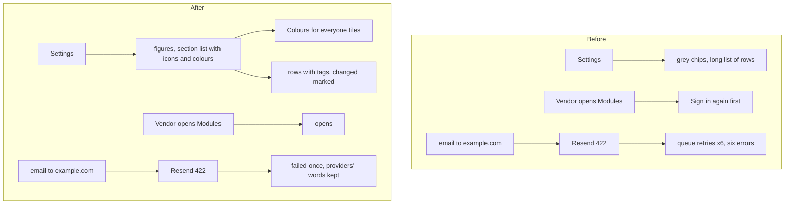

# The Settings page redesigned, the Vendor never asked to sign in again, refusals that fail once

> **In plain words.** On 2026-11-11 the owner said the Settings page was not looking good at all
> and asked for icons, colour palettes, a better arrangement and more. Now the page opens with four
> figures (how many settings, how many changed, how many sections, how many wait for a deploy).
> Each section has its own icon and colour, the same colours as the sidebar's groups, and a line
> saying what it holds. On a computer the sections are a list down the left that stays in view as
> the page scrolls; on a phone they are a sideways row. A changed setting is marked along its left
> edge. Whoever may change the portal's look sees **Colours for everyone** first: every palette and
> background as a tile, saved with the same Save as the rest. The same night the owner, signed in
> as the Vendor, was asked to sign in again on the Modules page, and the error list showed an email
> to an `example.com` address refused six times. The Vendor is now never asked to sign in again (the
> owner's ruling of 2026-11-08), and an email every provider refused for itself fails once, in the
> providers' own words, instead of being sent back to be refused again.

The page was checked against the owner's design skills (public copies of Emil Kowalski's design
engineering, Hallmark, Vercel's Web Interface Guidelines and UI/UX Pro Max): no middle-dot meta
lines, 44 px rows in the section list, presses that shrink a little, options in sideways rows on a
phone, colour that says a group or a state.

## What changed

| Part | Before | After |
| --- | --- | --- |
| The top of Settings | one line and a row of grey section chips | four figures, then the section chips with icons on a phone |
| Sections | a plain heading | an icon tile in the group's colour, a line on what it holds, its count and how many are changed; a list down the left on a computer that stays in view |
| Rows | words beside a wide box, the default and last change in one dotted line | words over the box in the narrower column; the default and last change as small tags; a changed row marked along its edge |
| The portal's colours | only on the Look page, by Make it everyone's look | also **Colours for everyone** on Settings, tiles for the 24 palettes and 7 backgrounds |
| A fresh sign-in | asked of everyone, the Vendor too, for the capabilities flagged for it | asked of everyone but the Vendor (`can` in `@oltrem/iam`; the email module's delivery reports address the same) |
| An email every provider refused for itself (a 4xx, such as Resend's 422 for `example.com`) | sent back to the queue and refused again, up to six times, each time an error on the error list | failed once, with what each provider said, on the message |

## Before and after

## Impact on each part

- **The kit's screens**: `SettingsList` (figures, section faces, the section list, the Look card),
  `POST /settings` joins `look:palette` and `look:pattern` into `settings.look`. The stylesheet stays
  under its 128 KiB cap.
- **The IAM module**: the Vendor's allow carries no fresh sign-in flag.
- **Oltrem Mail, email module**: the refusal rule and the delivery reports address (taken in from
  Oltrem Mail 2299c18).
- **Workers, settings, variables, migrations, dependencies**: none new.

## How it was verified

- Tests: `packages/screens/test/settings.test.ts`; the client template's screens test (the tiles
  shown, a look left as shown saves nothing, a new one saved as `ocean.dots` and put back);
  `modules/iam/test/iam.test.ts` (the Vendor's allow without the flag, the Owner's with it); Oltrem
  Mail `modules/email/test/email.test.ts` (two providers answering 422 fail the message at once; the
  Vendor reads the delivery reports address eleven minutes after signing in).
- Looked at on this computer with the template's portal (`dev --mail`), computer 1440 x 900 light
  and dark and phone 390 x 844 dark: the figures, the section list staying in view, the tiles, a
  palette and a number saved together with one Save and the portal recoloured.
- The client template's screens test now waits five seconds after its last test: the local queue
  delivers on its own time, and where a provider cannot be reached (this computer has no outside
  network) a delivery's error was still being printed as the runtime closed, which failed two full
  runs with every test passing. Two runs after the wait were clean.
- Phone tests P121 to P123 in [phone tests](../phone-tests.md).
