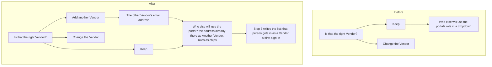

# The setup page: another Vendor, and a new look

> **In plain words.** On 2026-11-11 the owner sent a screenshot of step 2 of the setup page,
> "Who signs in", where the Vendor's question offered only **Keep** and **Change**. He asked for a
> way to add another Vendor there, and for better looks and UI/UX on the whole page. Step 2 now
> has a third choice, **Add another Vendor**: it asks for the address and puts it in the next
> question's list as Another Vendor, where it can still be taken out before Continue. The whole
> page (the start page and `npm run setup`) now has the portal's Look 3 feel: a band at the top
> that names the one next move, a ring that shows how far the seven steps have come, the steps
> joined by a line, soft tinted questions and answers, role chips in place of the dropdown, icons
> on the sections and tiles, and the portal's motion timings.

## What changed

| Part | Before | After |
|---|---|---|
| Step 2, a Vendor already set | Keep, or Change the Vendor | Keep, **Add another Vendor**, or Change the Vendor. Add asks "The other Vendor's email address", refuses the Vendor's own address or one that is not an address, says it in one line and fills the list question with that address as Another Vendor |
| The list of people | a dropdown for each person's role | a row of role chips under each address (they wrap on a computer and scroll sideways on a phone); each row is a soft card |
| Start page, Overview | three tiles, and a "now" strip only while something runs | while nothing runs, a band names the one next move from what the start found: what to fix first on this computer, **Put it live** (with **Try it here first**), or the live address with **Open the portal** and **Update it**. The tiles have a coloured icon each and lift a little under the pointer |
| Put it on Cloudflare, its card | a bar of seven and a line of text | a band with a ring (steps done of seven, blue while running, amber when it needs you, green when done, red when stopped), the step's name as its heading, and the bar of seven under it |
| The seven steps | separate cards; waiting steps dashed | one line joins the numbers; a waiting step is a plain row on the line; the step running has a tinted head and its number pulses softly (amber when it needs you) |
| A question | a box with a thick amber edge | a card with a soft amber wash and ring; choice cards tint in the portal's colour when chosen; the radio button's own square focus ring is gone (the card shows focus) |
| An answer | a grey box | a soft green box with a green tick |
| Finished | a green-edged callout | a larger green band with a tick in a circle |
| The frame | solid top bar | the top bar and the section row are translucent with a blur; the mark has a gradient; a soft colour wash at the top of the page; each section has an icon |
| Motion | none | what appears rises 6 px out of a 4 px blur in 320 ms (the portal's timing), sections 60 ms apart; lines rise 4 px; with reduce motion on, nothing moves |

Nothing about what the page sends changed: the answers, the events and the rules the tests run are
the same. Colours are still the portal's theme tokens (the test that compares them passes).

## Before and after

Before, a second Vendor could be named only in the list question, by picking "Another Vendor" in
a dropdown, which the owner did not see from step 2. After, step 2 offers it, and the list
question shows it with its role chosen, so the same list (and the same first sign-in,
`@oltrem/iam`'s people named at setup) carries it.

## How it was verified

- `packages/cli/test/deploy.test.ts`, "another Vendor added at step 2": the three choices, the
  address asked next, the list question filled with `address<TAB>vendor`, `iam.setup_people`
  written with the vendor role, the Vendor's own row unchanged, and the two refusals.
- The page drawn in a headless browser from scripted events (step 2's question, the list, step 5
  running, step 7's modules, a stop, the end, the start page idle and live) at 1440 px and 390 px,
  light and dark, and looked at.
- An axe check (WCAG 2 A and AA) on those seven states, light and dark, with reduce motion: no
  violations.
- `pnpm verify` green before the push.

Not checked: the page on the owner's own computer and browser; that is phone test P124 and P125.
