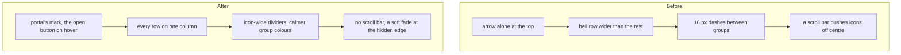

# The sidebar tidied

> **In plain words.** The owner sent a screenshot of the closed sidebar on 2026-11-11 and said
> its arrangement, alignment, colours and scroll bar looked wrong. Measured on this computer:
> the Notifications row sat 12 px left of every other row, so its icon was off the column and
> its tint touched both edges of the rail; the dividers between groups were 16 px dashes; the
> closed rail lost the portal's mark and showed only an arrow; a scroll bar, where the computer
> draws one, pushed the icons off the centre line; and the icons were small and bright. Now
> every row sits on one column with 18 px icons on the rail's centre line, the closed rail keeps
> the portal's mark at the top and shows the open button over it on hover, the dividers are an
> icon wide, the unread count is a badge on the bell, the rail has no scroll bar and the list
> fades softly where more of it is hidden. Each group keeps its colour, a little calmer at rest
> and full on hover and on the section on screen.

## What changed

| Part | Before | After |
|---|---|---|
| Notifications row | the rail's full width, 12 px left of the other rows | inset 12 px like every row |
| Icons | 16 px, the group's full colour | 18 px; at rest the group's colour mixed 72% with the muted grey (in oklab, so the hue never turns), full colour on hover and on the section on screen |
| Closed rail, top | the open arrow alone | the portal's mark; the open button appears over it on hover or keyboard focus |
| Closed rail, centre line | icons at 33 px of a 64 px rail, and off it by a scroll bar's width where one is drawn | icons at 32 px; no scroll bar on the rail |
| Dividers on the closed rail | 16 px dashes | 28 px lines |
| Unread count, closed | squeezed out of the row | a small badge on the bell's corner |
| The list's edges | rows cut off under the account line | the list fades at an edge where more of it is hidden (scroll-driven, where the browser has it) |

## Before and after

## Impact

Stylesheet only, about 1 KiB built; no markup, script, Worker or data change. The phone's menu
gets the inset bell, the larger icons and the fades too.

## How it was verified

- The screens stylesheet test checks each rule above.
- On this computer, light and dark, open and closed: every row's left edge at 12 px, every icon's
  centre at 32 px on the closed rail, the mark at the top and the open button on hover with its
  label beside it, the fade over the last rows; the phone's menu with the bell in line.
- Phone tests P107 and P108 in [phone-tests.md](../phone-tests.md).
