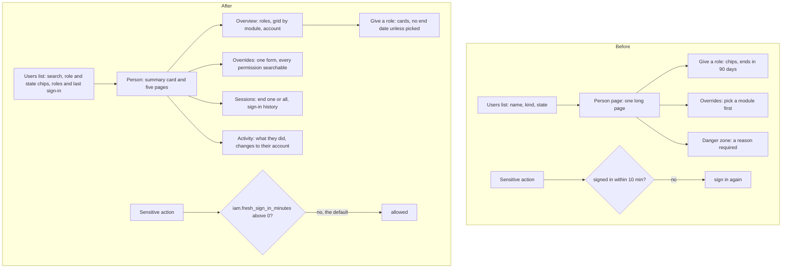

# The Users pages remade

> **In plain words.** On 2026-11-11 the owner said the permission system was confusing, hard to
> grant, asked people to sign in again every ten minutes, and that the Users pages were hard to
> follow; he asked for a large round of improvements to user info, changing access, granular
> visuals and features, and named what he wanted: ending and blocking sessions, session logs,
> user activity, temporary permissions and more control over each account. Now nobody is asked
> to sign in again unless the Vendor turns it on; a role lasts until someone ends it unless an
> end is picked; the Users list is searchable and shows each person's roles and last sign-in;
> each person has a summary card and five pages of their own (overview, what they can do,
> permission overrides, sessions, activity); a role is picked from cards that say what it does;
> a permission override is one form with every permission searchable; and the Users & access
> pages are sections in the sidebar instead of a row of tabs.

## What changed, and why

| Part | Before | After |
|---|---|---|
| Sign in again for sensitive actions | 10 minutes for everyone but the Vendor, fixed in code | the setting `iam.fresh_sign_in_minutes` (Settings, Security, the Vendor's), 0 to 1,440; **0, the default, asks nobody** |
| A role's end | every role but the Owner's ended after 90 days unless another end was picked ("Review access in" 30, 90, 365) | **no end date** unless one is picked: "Access ends" offers No end date (chosen), 8 hours, 1 day, 1 week, 30 or 90 days; the setting `iam.grant_days` (Settings, Users & access, an Owner's) can set an end for every grant given without one; 0 by default |
| Changing a role | the new grant got a 90-day end and lost "only when switched on" | the old end is offered first as "Keep"; "only when switched on" is kept |
| Users list | name, a "Kind" column and the state; Active or Deactivated chips over the figures; no search | each row the person's initials, name, address, last sign-in in words, their roles as badges and their state; a search box; Everyone, Active, Deactivated and Invited chips with counts; a chip per role with how many hold it |
| Inviting | a form at the bottom of the list, roles as bare chips | its own page, the roles as cards saying what each lets a person do and how many hold it, and the invitations waiting |
| A person's page | one long page: a summary, roles, a table of 30 modules, overrides, a Danger zone needing a reason | a summary card (role, last sign-in, member since) and a row of their pages; the overview: roles, give a role or temporary access, a colour grid of every module by level, overrides, and Account (name, Sign out everywhere, Deactivate with an optional reason in a dialog) |
| Sessions | a person could see and end only their own | Sessions: each browser they are signed in on with End, Sign out everywhere, and the sign-in history |
| Activity | only the Audit log, filtered by address | Activity: what they did, or what was done to their account, in plain words |
| Permission overrides | pick a module from a row, then a permission; Deny hidden under "advanced"; a 90-day end by default | one form: every permission grouped by module with a search box and "Has it now" or "Not now" beside each; Allow or Deny in view; no end date unless picked |
| Users & access navigation | one sidebar entry and a row of seven tabs on every page | Users, Roles, Groups, Locations, Access requests, Access reviews and Vendor access each a sidebar section, shown to whoever may open it |
| Chip rows on a phone | a row longer than the screen could widen the whole page (the hidden radio of a chip escaped the row) | the row holds its radios; measured on Invite, overrides and Settings: no sideways scroll of the page |

New in the API, for these pages:

- `iam`: a new browser's sign-in is recorded once, after the answer: `last_signed_in_at` on the
  account (migration `0058`) and the audit row `iam.sign-in`. `Sessions.revokeAll` ends every
  open sign-in in one KV write.
- `users`: `GET /people/:id/sessions`, `DELETE /people/:id/sessions/:device`,
  `POST /people/:id/sign-out` (`users.manage`; never your own; an Owner or the Vendor for anyone,
  anyone else below their standing), audited `users.session-end` and `users.sign-out`; the
  deactivate reason is optional.
- `audit`: `GET /entries` filters by `target` and `action` too, with an index on the target
  (migration `0059`).

## How it worked before and how it works now

Before, giving access meant choosing a review date that quietly ended the role three months
later, and every sensitive action could stop a person mid-task to sign in again. Now access lasts
until someone ends it, temporary access is one chip away, and a person's sessions and history are
on their own pages.

## Impact on each part

- **CPU.** The new reads are database and KV reads inside the Worker's own API calls; nothing new
  runs per request. A sign-in is recorded once per browser, after the answer, in one batch. A
  person's pages make two to five in-process API calls, like the page they replace.
- **KV.** No new writes per request; "Sign out everywhere" is one write.
- **Database.** One column (`0058`) and one index (`0059`), both additive.
- **Settings.** Two new rows on Settings, both off by default; no variable or secret.
- **Stylesheet.** About 1.2 KiB built; 364 bytes remain under the screens' 128 KiB test cap, so
  the next change that adds classes needs to trim first.

## How it was verified

- `iam` tests: the fresh window from the setting, 0 asks nobody; grants with no end; the
  `iam.grant_days` setting; `revokeAll`; a sign-in recorded with its audit row.
- `users` tests: the three sessions routes, the refusals after an end, deactivate without a reason.
- Screens tests: the invitation's cards and Access ends chips, `endsAt` and `grantFields`, the
  sidebar's sections per viewer, the list, a person's head, the grid, sign-ins and activity in
  words, the one-form override.
- The portal's page tests: the whole flow from invite to role change, overrides, name change,
  ending a sign-in, signing out everywhere and both activity views.
- On this computer at 390 px and 1280 px: the Users list, Invite, a person's overview, Sessions,
  Activity and overrides; the page no longer scrolls sideways on Invite, overrides or Settings.
- Not verified: a real phone (P133 to P137 in [Phone tests owed](../phone-tests.md)).
